# Phase 3: Reasoning Finetuning, Attention Analysis, and Final Report

Two monolingual decoder-only language models, built independently end to end:
Telugu as **Model H** (higher-resource) and Nepali as **Model L**
(lower-resource). Phase 1 collected and cleaned the corpora and trained the
tokenizers, Phase 2 implemented the transformer from primitive PyTorch layers
and pretrained both models, and Phase 3 finetunes each on a synthetic
comparative-reasoning set written in its own language, re-runs the attention
analysis on the finetuned checkpoints, and adds the optional
no-positional-embedding ablation.

Nothing is shared between the two languages at any stage: separate corpora,
separate tokenizers, separate vocabularies, separate configs, separate weights,
separate finetuning data.

| | Telugu (Model H) | Nepali (Model L) |
|---|---:|---:|
| Corpus | 639,877,839 tokens | 497,000,869 tokens |
| Tokenizer | SentencePiece unigram, 8,000 | SentencePiece unigram, 32,000 |
| Parameters | 24,562,944 | 24,906,624 |
| Layers × heads | 12 × 6 | 7 × 6 |
| Pretraining steps | 20,700 (2.12 epochs) | 16,000 (2.11 epochs) |
| Test perplexity | 24.15 | 59.37 |
| **Test bits per byte** | **0.4588** | **0.4529** |
| Reasoning, finetuned exact match | **40.00%** | **9.11%** |
| Reasoning, likelihood-ranked choice | **41.75%** | **35.11%** |
| Ablation cost at matched step | +0.094 nats | +0.128 nats |

**The headline for Phase 3 is a negative result, and it is worth stating
plainly at the top.** Finetuning taught both models the *output format* of the
task but, with one measurable exception, not the *comparison* the task is about.
Model H ends up roughly at the chance rate on four of five template families and
shows a real but small improvement on one; Model L does not clear chance on any
of them. Section 4 quantifies this carefully against three separate baselines
rather than reporting an accuracy number that would flatter the work.

---

## 1. The synthetic reasoning dataset

### 1.1 What it is and why it is generated rather than downloaded

The reasoning set is built programmatically so the
ground-truth labels are known by construction. `common/reasoning/generate.py`
does exactly that: it draws the underlying structure first, the entities, the
numeric values, or a hidden ordering, and *then* renders sentences from it. The
answer is a consequence of the draw, never an annotation or a judgement about
text, so it cannot be wrong.

No reasoning benchmark was downloaded, nothing was translated, and no language
model was involved in producing any of the data. The generator imports only
`json`, `random`, `dataclasses`, `pathlib` and `yaml`.

Every string a generated example can contain lives in
`telugu/configs/reasoning.yaml` and `nepali/configs/reasoning.yaml` rather than
in the code, so the phrasing can be reviewed and corrected by a native speaker
without touching the generator. Both files are seeded (`seed: 20260909`) and the
dataset reproduces byte for byte.

### 1.2 The five template families

| family | statements | what it tests | hops |
|---|---|---|---:|
| `two_way_value` | two entities with stated values | read two numbers, compare | 1 |
| `equality` | two entities, equal or unequal values | compare two numbers, answer yes/no | 1 |
| `three_way_value` | three entities with stated values | find the maximum or minimum of three | 2 |
| `transitive_3` | two chained inequalities, **no numbers at all** | compose A>B, B>C | 2 |
| `transitive_4` | three chained inequalities over four entities | compose A>B>C>D | 3 |

"Hops" is the number of statements that must be combined to answer. The chain
families contain no numeric values whatsoever, so the only route to the answer is
composing the inequalities.

A real generated example from each family, Telugu on the left of the pair and
Nepali beneath it:

```
[two_way_value, 1 hop]
  భాస్కర్ బరువు 83 కిలోలు. చంద్ర బరువు 95 కిలోలు. ఎవరి బరువు ఎక్కువ? సమాధానం: చంద్ర.
  भास्करको तौल 83 किलो हो। चन्द्रको तौल 95 किलो हो। कसको तौल बढी छ? उत्तर: चन्द्र।

[equality, 1 hop]
  అద్దం ధర 1450 రూపాయలు. బుట్ట ధర 340 రూపాయలు. రెండింటి ధర సమానమేనా? సమాధానం: కాదు.
  ऐनाको मूल्य 1450 रुपैयाँ हो। टोकरीको मूल्य 340 रुपैयाँ हो। के दुवैको मूल्य बराबर छ? उत्तर: होइन।

[three_way_value, 2 hops]
  చంద్ర బరువు 59 కిలోలు. భాస్కర్ బరువు 75 కిలోలు. రేఖ బరువు 53 కిలోలు. ఎవరి బరువు అందరికంటే తక్కువ? సమాధానం: రేఖ.
  चन्द्रको तौल 59 किलो हो। भास्करको तौल 75 किलो हो। रेखाको तौल 53 किलो हो। कसको तौल सबैभन्दा कम छ? उत्तर: रेखा।

[transitive_3, 2 hops]
  తేజ వయస్సు రేఖ వయస్సు కంటే ఎక్కువ. భాస్కర్ వయస్సు తేజ వయస్సు కంటే ఎక్కువ. ఎవరి వయస్సు అందరికంటే తక్కువ? సమాధానం: రేఖ.
  तेजको उमेर रेखाको उमेर भन्दा बढी छ। भास्करको उमेर तेजको उमेर भन्दा बढी छ। कसको उमेर सबैभन्दा कम छ? उत्तर: रेखा।

[transitive_4, 3 hops]
  యమున ఎత్తు అశోక్ ఎత్తు కంటే ఎక్కువ. తేజ ఎత్తు నందిని ఎత్తు కంటే ఎక్కువ. నందిని ఎత్తు యమున ఎత్తు కంటే ఎక్కువ. ఎవరి ఎత్తు అందరికంటే ఎక్కువ? సమాధానం: తేజ.
  यमुनाको उचाइ अशोकको उचाइ भन्दा बढी छ। तेजको उचाइ नन्दिनीको उचाइ भन्दा बढी छ। नन्दिनीको उचाइ यमुनाको उचाइ भन्दा बढी छ। कसको उचाइ सबैभन्दा बढी छ? उत्तर: तेज।
```

**The statements are shuffled inside every example**, which matters more than it
looks. In the `transitive_4` example above the chain is
तेज > नन्दिनी > यमुना > अशोक, but the sentences appear in the order
यमुना>अशोक, तेज>नन्दिनी, नन्दिनी>यमुना. A model that always answered with the
first-mentioned entity would score at or below chance, and §4.1 confirms that it
does.

Four comparable attributes are used, each with its own unit and range: height in
centimetres (140–195), age in years (5–80), weight in kilograms (30–95) and
price in rupees (20–4000). Height, age and weight attach to people; price
attaches to objects.

**A note on the phrasing.** Both template sets deliberately express comparisons
as noun phrases ("X's height is more than Y's height") rather than adjectival
predicates ("X is taller"). Telugu adjectival predicates inflect for gender, so
a predicate template would require the generator to know each name's gender and
would produce ungrammatical text whenever it guessed wrong. Noun-phrase
comparison avoids the problem in both languages and keeps the two datasets
structurally identical. Each Telugu pool also carries its own interrogative and
quantifier, because Telugu distinguishes animate from inanimate in all three:
ఎవరి / దేని, అందరికంటే / అన్నిటికంటే, ఇద్దరి / రెండింటి.

I am not a fluent speaker of either language. The phrasing is my own and would
benefit from a native speaker's review; it is isolated in the two YAML files
precisely so that review costs nothing in code.

### 1.3 Size and composition

Both languages use identical split sizes and identical family proportions, so any
difference in results comes from the models rather than from the data.

| split | examples | families | distinct entities | mean chars | max chars | distinct answers | best constant answer |
|---|---:|---:|---:|---:|---:|---:|---:|
| train | 22,000 | 4 | 34 | 104 | 140 | 36 | 9.17% |
| validation | 1,500 | 4 | 8 | 107 | 139 | 10 | 13.47% |
| test | 3,600 | 5 | 12 | 112 | 168 | 14 | 9.06% |

(Telugu figures; Nepali is within one character on every mean, 104 / 103 / 113.)

Per family, and note the zero:

| family | train | validation | test |
|---|---:|---:|---:|
| `two_way_value` | 6,000 | 400 | 800 |
| `three_way_value` | 6,000 | 400 | 800 |
| `transitive_3` | 6,000 | 400 | 800 |
| `equality` | 4,000 | 300 | 600 |
| **`transitive_4`** | **0** | **0** | **600** |

By hop count: training is 10,000 one-hop and 12,000 two-hop examples; test is
1,400 one-hop, 1,600 two-hop and 600 **three-hop**, the last of which the model
has never seen in any form.

Attribute coverage on the test split is close to balanced: age 958, height 923,
weight 938, price 781.

### 1.4 How train–test leakage is prevented

The generator implements **two
independent controls** and then *checks* both rather than assuming them.

**Control 1: disjoint entity pools.** Every split draws from its own list of
names and objects. No name the model saw during finetuning appears at evaluation.

- train: 26 people + 8 objects = 34 entities
- validation: 6 people + 2 objects = 8
- test: 8 people + 4 objects = 12

**Control 2: a held-out relation pattern.** `transitive_4` is generated for the
test split only. The model never sees a four-entity chain in training, so its
accuracy on those 600 examples measures whether it learned to *compose*
inequalities or merely memorised the three-term surface form.

`scripts/30_make_reasoning.py` verifies both at generation time and refuses to
write the dataset if either fails. Measured, both languages:

| check | result |
|---|---|
| entities shared train↔validation | **0** |
| entities shared train↔test | **0** |
| entities shared validation↔test | **0** |
| prompts repeated train↔validation | **0** |
| prompts repeated train↔test | **0** |
| prompts repeated validation↔test | **0** |
| families held out of training | **`transitive_4`** |

The prompt check is a belt-and-braces duplicate scan over the exact prompt
strings; it is redundant given disjoint pools, but it costs nothing and would
catch a config edit that accidentally overlapped two pools.

The generator also deduplicates within each split, with only eight test people
there are a finite number of distinct three-entity comparisons, so a repeated
prompt is redrawn rather than kept.

---

## 2. Finetuning

### 2.1 Protocol

Each model starts from **its own** pretrained checkpoint, keeps **its own**
tokenizer and vocabulary unchanged, and sees only **its own** language's data.
Nothing crosses.

| | Telugu | Nepali |
|---|---|---|
| Started from | `tel_best.pt`, step 20,700 | `nep_best.pt`, step 16,000 |
| Vocabulary | 8,000, unchanged | 32,000, unchanged |
| Architecture | unchanged (12 × 6, d=384) | unchanged (7 × 6, d=384) |
| Training examples | 22,000 (691,133 tokens) | 22,000 (735,472 tokens) |
| Validation examples | 1,500 (48,659 tokens) | 1,500 (49,149 tokens) |
| Dropped as too long | 0 | 0 |
| Prompt-boundary mismatches | 0 | 0 |
| Steps | 1,500 | 1,500 |
| Wall clock | 6.0 min | 5.8 min |

Hyperparameters, identical for both languages by design so that any difference in
outcome is a property of the models rather than of the recipe:

| | value | why |
|---|---|---|
| Optimiser | AdamW, β = (0.9, 0.95) | same as pretraining |
| Learning rate | **3e-5 → 3e-6** | an order of magnitude below pretraining's 3e-4: the model already speaks the language, and the pretraining rate erases that |
| Schedule | 100-step warmup, then cosine | |
| Batch | 32 × 2 accumulation = **64 examples/step** | |
| Weight decay | 0.1, on ≥2-dim tensors only | |
| Gradient clipping | global norm 1.0 | |
| Dropout | **0.05**, down from 0.1 | 22,000 short examples seen repeatedly; the disjoint pools already provide the generalisation pressure |
| Loss | **answer tokens only** | the prompt is given, not predicted; scoring it lets the model lower the loss by restating the question |
| Seed | 1337 | |
| Evaluation | every 100 steps, full validation split | |

**Loss masking.** `common/reasoning/data.py` tokenises the full example, locates
the prompt boundary by tokenising the prompt separately and verifying it is a
prefix of the full encoding, then sets every prompt position to `-100` so
`cross_entropy` ignores it. The verification matters because SentencePiece can
merge across the join; where it does, the example falls back to loss on all
tokens and is counted. **Both languages recorded zero boundary mismatches**, so
the masking is exact for all 23,500 examples.

Padding goes on the right and needs no attention mask: attention is causal, so a
pad can only be seen by positions after it, and every target from the padding
onwards is already ignored.

Checkpoints are written in the same resumable format as pretraining, weights,
optimizer state, `GradScaler` state, step counter, best validation loss, full
history and both configs, written to a temp file and renamed.

### 2.2 Both models overfit almost immediately, and this is the key observation

| step | Telugu val loss | Nepali val loss |
|---:|---:|---:|
| **100** | **0.6334** | **2.5762** |
| 200 | 0.6337 | 2.8263 |
| 300 | 0.7651 | 3.3645 |
| 400 | 0.9087 | 3.6770 |
| 500 | 0.9733 | 3.8783 |
| 700 | 1.0903 | 4.2006 |
| 1,000 | 1.1318 | 4.4032 |
| 1,500 | 1.0896 | 4.4350 |

**For both languages the very first evaluation is the best one, and validation
loss rises monotonically afterwards.** Training loss keeps falling, the model is
memorising 22,000 templated examples, which a 25M-parameter model does quickly.
1,500 steps at 64 examples per step is 4.4 passes over the data; the evidence
says roughly 0.3 passes was the right amount.

Two consequences:

1. **The checkpointing handled it correctly.** `*_ft_best.pt` was saved at step
   100 in both cases, and stage 32 evaluates `--checkpoint best` by default, so
   every accuracy number in §4 comes from the step-100 model rather than the
   overfitted one. `best validation loss` equalling `first validation loss`
   confirms step 100 was never beaten.
2. **The configuration is wrong and should be fixed.** `max_steps: 1500` with
   `eval_every: 100` is roughly 15× more budget than this dataset supports. A
   corrected recipe is `max_steps: 200, eval_every: 25`, which would locate the
   minimum far more precisely and cost under a minute. This is recorded as a
   limitation rather than silently left in the configs.

**Telugu's finetuning loss is far lower than Nepali's at every step**, 0.63
against 2.58 at the minimum, a factor of four. That gap is the first quantitative
sign of what §4 shows behaviourally: Model H learns the task format easily and
Model L struggles with it.

---

## 3. How reasoning is measured

Two measurements are reported, because they answer different questions, and
three baselines, because an accuracy number without them is uninterpretable.

**Generation (exact match).** The model is given the prompt, decodes greedily
for up to 16 tokens, and its output up to the first sentence terminator must
equal the gold answer exactly. This is the honest end-to-end test and the one
this measures. It is also unforgiving: a pretrained model that has
never seen the answer marker scores zero for reasons of *format*, not reasoning.

**Likelihood-ranked choice.** The candidate answers are known by construction, so
each one is scored by its length-normalised log-likelihood under the model and
the best is taken. Length normalisation matters, without it the shortest name
wins far more often than it should. This separates "cannot produce the format"
from "does not know the answer", which makes the pretrained baseline
interpretable instead of a flat zero.

**Three baselines**, all computed on the same 3,600 test examples:

| baseline | Telugu | Nepali | what it is |
|---|---:|---:|---|
| Random choice | **38.43%** | **38.43%** | expected accuracy of guessing uniformly among each example's candidates |
| Best constant answer | 9.06% | 9.06% | always emitting the single most frequent gold string |
| First entity named | 26.92% | 34.53% | always answering with whichever candidate appears earliest in the prompt |

The random-choice rate is 38.43% rather than 50% or 25% because the families have
different candidate counts: two-way and equality have 2, the three-entity
families have 3, and `transitive_4` has 4. **Any accuracy must be read against
38.43%, not against zero.**

That "first entity named" scores 26.92% and 34.53%, both *below* chance,
confirms the statement shuffling works. There is no positional shortcut to find.

---

## 4. Reasoning results

### 4.1 Headline numbers

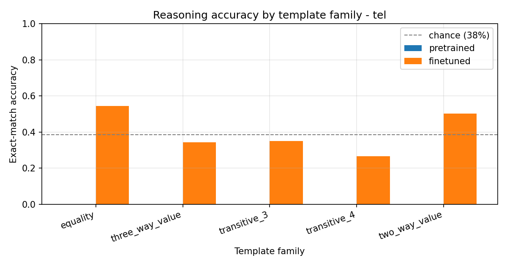

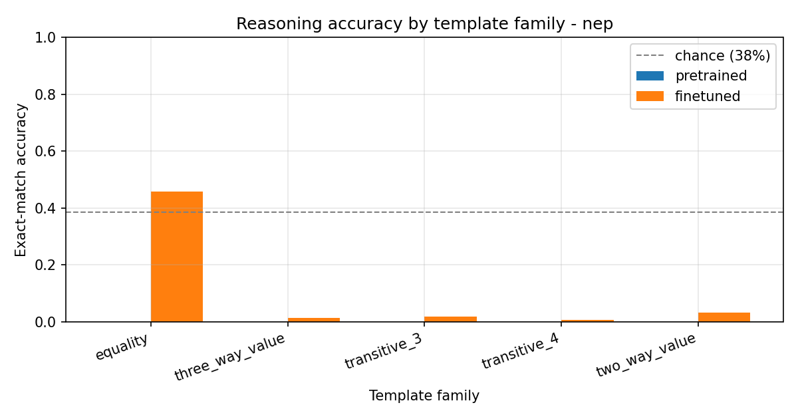

| | Telugu pretrained | Telugu finetuned | Nepali pretrained | Nepali finetuned |
|---|---:|---:|---:|---:|
| Checkpoint | `tel_best.pt`, step 20,700 | `tel_ft_best.pt`, step 100 | `nep_best.pt`, step 16,000 | `nep_ft_best.pt`, step 100 |
| **Exact match (generation)** | **0.00%** | **40.00%** | **0.00%** | **9.11%** |
| **Likelihood-ranked choice** | **35.61%** | **41.75%** | **35.75%** | **35.11%** |
| Random-choice baseline | 38.43% | 38.43% | 38.43% | 38.43% |

Read against the baseline rather than against zero:

- **Telugu finetuned exact match, 40.00%, is 1.57 points above the 38.43% chance
  rate.**
- **Nepali finetuned exact match, 9.11%, is 29 points *below* chance.**
- Telugu's choice accuracy improves by 6.14 points and ends 3.32 points above
  chance; Nepali's *decreases* by 0.64 points and ends 3.32 points below it.

Both pretrained models score exactly 0.00% on generation. That is the expected
format failure, not a reasoning failure (see the qualitative section for what
they actually emit.

### 4.2 Per-family breakdown against chance

This is where the result becomes legible. Chance differs per family, so the
comparison column is what matters.

**Telugu**

| family | n | chance | pretrained gen | finetuned gen | pretrained choice | finetuned choice | choice − chance |
|---|---:|---:|---:|---:|---:|---:|---:|
| `two_way_value` | 800 | 50.0% | 0.0% | 50.12% | 52.12% | 50.50% | **+0.5** |
| `equality` | 600 | 50.0% | 0.0% | 54.33% | 45.67% | 54.33% | **+4.3** |
| `three_way_value` | 800 | 33.3% | 0.0% | 34.25% | 32.87% | 34.38% | **+1.0** |
| `transitive_3` | 800 | 33.3% | 0.0% | 34.88% | 28.25% | **40.75%** | **+7.4** |
| `transitive_4` (held out) | 600 | 25.0% | 0.0% | 26.67% | 17.00% | 28.67% | **+3.7** |

**Nepali**

| family | n | chance | pretrained gen | finetuned gen | pretrained choice | finetuned choice | choice − chance |
|---|---:|---:|---:|---:|---:|---:|---:|
| `two_way_value` | 800 | 50.0% | 0.0% | 3.25% | 50.62% | 49.38% | **−0.6** |
| `equality` | 600 | 50.0% | 0.0% | 45.67% | 45.67% | 45.67% | **−4.3** |
| `three_way_value` | 800 | 33.3% | 0.0% | 1.38% | 32.75% | 32.50% | **−0.8** |
| `transitive_3` | 800 | 33.3% | 0.0% | 1.75% | 29.00% | 28.25% | **−5.1** |
| `transitive_4` (held out) | 600 | 25.0% | 0.0% | 0.50% | 19.00% | 18.17% | **−6.8** |

**What this says, stated without varnish:**

- **Model L learned nothing about the comparison.** Every family sits at or below
  chance on choice accuracy, and its generation accuracy collapses to 0.5–3.3%
  on the four entity-answer families. Finetuning moved it backwards on choice.
- **Model H learned the format and one thing about the task.** Four of its five
  families land within 1.0–4.3 points of chance, which is not a reasoning
  signal. `transitive_3` is the exception: **+7.4 points over chance on choice
  accuracy, and +12.5 points over its own pretrained score** (28.25% → 40.75%).
  That is the only family where something real was learned.
- **Neither model generalised to the held-out pattern.** `transitive_4` reaches
  28.67% against 25% chance for Telugu and 18.17% against 25% for Nepali. The
  held-out relation pattern did its job, it shows that whatever Telugu picked up
  on three-term chains did not compose to four terms.

### 4.3 By number of hops

| hops | n | Telugu ft gen | Telugu ft choice | Nepali ft gen | Nepali ft choice |
|---:|---:|---:|---:|---:|---:|
| 1 | 1,400 | 51.93% | 52.14% | 21.43% | 47.79% |
| 2 | 1,600 | 34.56% | 37.56% | 1.56% | 30.38% |
| 3 (held out) | 600 | 26.67% | 28.67% | 0.50% | 18.17% |

Accuracy falls monotonically with hop count for both models and both
measurements. That is the expected shape, but it is also exactly what chance
alone produces here, since more hops coincides with more candidates. The hop
curve is therefore not by itself evidence of reasoning, and it should not be
presented as such.

### 4.4 Qualitative analysis: what the models actually emit

This is where the numbers get their explanation.

**What the pretrained models produce.** Given
`భాస్కర్ బరువు 83 కిలోలు. చంద్ర బరువు 95 కిలోలు. ఎవరి బరువు ఎక్కువ? సమాధానం:`
the pretrained Telugu model continues `- చంద్ర బరువు 83 కిలోలు`, fluent,
on-topic Telugu that continues the *document* rather than answering the
*question*. It has no notion that `సమాధానం:` demands a short answer. Nepali's
pretrained output is worse: `आयोजना आयोजना आयोजना…` repeated sixteen times, or a
string of `⁇` byte-fallback tokens. Both score 0.00%, for different reasons.

**What finetuning fixed.** For Telugu, all six sampled `fixed_by_finetuning`
cases are format repairs that happen to land on the right answer:

```
prompt : అద్దం ధర 1450 రూపాయలు. బుట్ట ధర 340 రూపాయలు. రెండింటి ధర సమానమేనా? సమాధానం:
gold   : కాదు
before : '- 1000 రూపాయలకు అమ్మితే రూ'
after  : 'కాదు'
```

**What it did not fix.** Six sampled `still_wrong` cases, all of them
well-formed answers that are simply wrong:

```
prompt : తేజ వయస్సు రేఖ వయస్సు కంటే ఎక్కువ. భాస్కర్ వయస్సు తేజ వయస్సు కంటే ఎక్కువ.
         ఎవరి వయస్సు అందరికంటే తక్కువ? సమాధానం:
gold   : రేఖ          (chain is భాస్కర్ > తేజ > రేఖ, so the smallest is రేఖ)
after  : 'భాస్కర్'     ← names the largest instead of the smallest
```

Zero examples were `broken_by_finetuning` in either language: finetuning never
turned a correct answer into a wrong one.

**The prediction distribution is the most informative artefact of the whole
phase.** Counting what each finetuned model emits across all 3,600 test items:

| | Telugu | Nepali |
|---|---|---|
| Distinct outputs | 28 | 36 |
| Empty outputs | 1 | 15 |
| Most frequent | `కాదు` (no) × 600 | `हो` (yes) × 1,003 |
| Next most frequent | `భాస్కర్` × 459, `యమున` × 358, `నందిని` × 328, `అశోక్` × 289 | `िनी` × 827, `कप` × 380, `अनु` × 201 |

Read those two columns side by side:

- **Telugu emits valid, whole entity names drawn from the correct test pool**,
  భాస్కర్, యమున, నందిని, అశోక్, తువ్వాలు, తేజ, బుట్ట, రేఖ, అద్దం, అనూష are all
  test-split entities. The model learned *which* words are legal answers. It
  just picks among them close to at random. (`నంది` × 122 is a truncated
  `నందిని`, the one systematic decoding defect.)
- **Nepali emits fragments.** `िनी` is a word-internal suffix piece, not a word.
  `ियाको` likewise. `कप` ("cup") is an object from the **training** pool, which
  cannot be a correct answer for any test example. Fifteen outputs are empty.
  Model L never learned the candidate vocabulary at all, which is precisely why
  its generation accuracy collapses to 0.5–3.3% on entity questions while its
  choice accuracy stays near chance, the ranking metric does not require it to
  *produce* the name.
- **`equality` is solved by a constant in both models.** Telugu answers `కాదు`
  (no) for all 600 equality items and scores 54.33%, which is exactly the
  majority-class rate, 326 of 600 gold answers are "no". Nepali answers `हो`
  (yes) and scores 45.67%, the complementary majority. Neither is comparing the
  two numbers; both found the prior.

### 4.5 Model H versus Model L on reasoning

| | Telugu (H) | Nepali (L) |
|---|---:|---:|
| Finetuned exact match | **40.00%** | 9.11% |
| Finetuned choice accuracy | **41.75%** | 35.11% |
| Best family over chance | `transitive_3`, **+7.4 pts** | none above chance |
| Held-out `transitive_4` vs chance | +3.7 pts | −6.8 pts |
| Best finetuning validation loss | **0.6334** | 2.5762 |
| Emits valid test-pool answers | yes | no, fragments and train-pool words |

**Model H is clearly ahead, and the gap is larger than the language-modelling
comparison would predict.** On bits-per-byte the two models are within 1.3% of
each other (§6), yet on this task one learns the answer vocabulary and shows a
measurable signal on one family while the other produces sub-word fragments.

§7 argues that the corpus-quality problem documented in Phase 2 is the most
plausible explanation.

---

## 5. Attention analysis, pretrained against finetuned

`scripts/33_attention_compare.py` reuses the Phase 2 attention toolkit
unchanged, the same `attention_entropy` and `mean_attention_distance`
functions, and runs it over the **same 16 comparative-reasoning prompts** for
both checkpoints, so the only variable is the weights.

Using reasoning prompts rather than corpus text is deliberate: the question is
whether finetuning changed how the model reads a *comparison*, and that only
shows on the inputs the finetuning was about.

### 5.1 Telugu: attention sharpens and contracts

16 prompts of 24 tokens; maximum attainable entropy at that length is **2.2827
nats**. 72 heads (12 layers × 6).

| statistic | pretrained | finetuned | change |
|---|---:|---:|---:|
| Mean entropy (nats) | 1.5133 | 1.4599 | **−0.0534** |
| Mean attention distance (positions) | 5.934 | 5.714 | **−0.221** |
| Heads that sharpened |, | **46 of 72** | |
| Heads that became more local |, | **50 of 72** | |

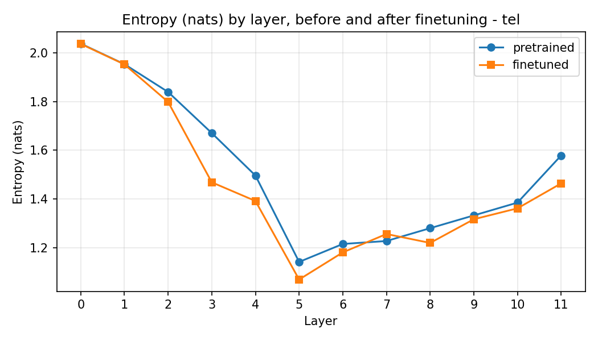

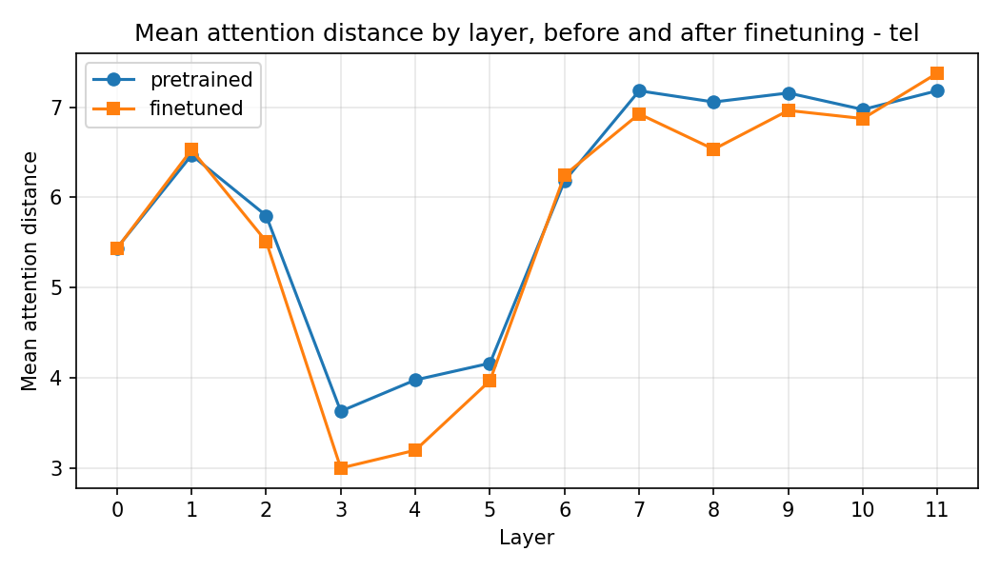

| layer | entropy before | after | Δ | distance before | after | Δ |
|---:|---:|---:|---:|---:|---:|---:|
| 0 | 2.0374 | 2.0363 | −0.001 | 5.439 | 5.435 | −0.004 |
| 1 | 1.9531 | 1.9522 | −0.001 | 6.469 | 6.528 | +0.060 |
| 2 | 1.8391 | 1.7983 | −0.041 | 5.799 | 5.512 | −0.286 |
| **3** | 1.6706 | **1.4686** | **−0.202** | 3.629 | **3.000** | **−0.630** |
| **4** | 1.4963 | 1.3921 | −0.104 | 3.977 | **3.197** | **−0.779** |
| 5 | 1.1421 | 1.0699 | −0.072 | 4.162 | 3.968 | −0.194 |
| 6 | 1.2158 | 1.1812 | −0.035 | 6.182 | 6.247 | +0.065 |
| 7 | 1.2279 | 1.2566 | +0.029 | 7.182 | 6.925 | −0.256 |
| 8 | 1.2805 | 1.2200 | −0.061 | 7.057 | 6.534 | −0.524 |
| 9 | 1.3329 | 1.3171 | −0.016 | 7.158 | 6.964 | −0.194 |
| 10 | 1.3854 | 1.3619 | −0.024 | 6.974 | 6.874 | −0.100 |
| 11 | 1.5788 | 1.4642 | −0.115 | 7.183 | 7.378 | +0.195 |

**The change is concentrated in layers 3–5 and in the final layer, and it is
almost absent in layers 0–1.** That maps directly onto the three-stage structure
found in Phase 2: the diffuse aggregation layers at the bottom are left alone,
while the *local sharpening* band, exactly the layers Phase 2 identified as
computing local syntax-like structure, sharpens further and pulls in.

Individual heads, largest entropy changes:

| head | Δ entropy | Δ distance |
|---|---:|---:|
| **L3 H3** | **−0.4397** | −0.604 |
| L11 H3 | −0.3906 | +1.423 |
| L3 H2 | −0.3293 | −0.598 |
| L3 H1 | −0.2778 | −0.416 |
| L4 H3 | −0.2480 | −0.506 |
| L7 H2 | +0.2143 | −1.167 |

Three of the six most-changed heads are in layer 3, and all three sharpen *and*
contract together. The interpretation I would defend: the model is learning to
attend to the two entity–value pairs in the prompt as local units, which is the
representation a comparison would need, even though §4 shows it does not go on
to perform the comparison reliably.

### 5.2 Nepali: attention sharpens but reaches further

16 prompts of 29 tokens; maximum entropy **2.4571 nats**. 42 heads (7 × 6).

| statistic | pretrained | finetuned | change |
|---|---:|---:|---:|
| Mean entropy (nats) | 1.9963 | 1.9274 | **−0.0688** |
| Mean attention distance (positions) | 6.281 | 6.834 | **+0.552** |
| Heads that sharpened |, | 20 of 42 | |
| Heads that became more long-range |, | **29 of 42** | |

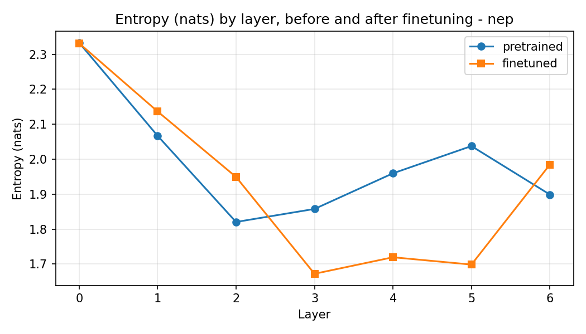

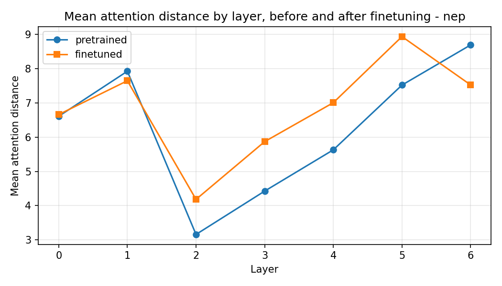

| layer | entropy before | after | Δ | distance before | after | Δ |
|---:|---:|---:|---:|---:|---:|---:|
| 0 | 2.3331 | 2.3316 | −0.002 | 6.611 | 6.661 | +0.051 |
| 1 | 2.0669 | 2.1366 | +0.070 | 7.926 | 7.648 | −0.278 |
| 2 | 1.8204 | 1.9491 | +0.129 | 3.160 | 4.183 | **+1.024** |
| 3 | 1.8577 | 1.6721 | −0.186 | 4.425 | 5.871 | **+1.445** |
| 4 | 1.9596 | 1.7194 | −0.240 | 5.631 | 7.008 | **+1.378** |
| **5** | 2.0375 | **1.6985** | **−0.339** | 7.522 | **8.938** | **+1.416** |
| 6 | 1.8987 | 1.9846 | +0.086 | 8.694 | 7.526 | −1.168 |

| head | Δ entropy | Δ distance |
|---|---:|---:|
| **L4 H2** | **−1.0189** | **+3.112** |
| **L5 H5** | **−1.0048** | **+3.633** |
| L5 H2 | −0.5524 | +3.008 |
| L3 H1 | −0.5334 | +3.136 |
| L5 H0 | −0.4333 | +1.175 |
| L6 H4 | +0.3615 | −2.669 |

**The two models moved in opposite directions on distance, and that is the most
interesting single finding in this section.** Telugu's attention contracted
(−0.22 positions, 50 of 72 heads more local); Nepali's expanded (+0.55
positions, 29 of 42 heads more long-range). Nepali's individual head changes are
also about twice the magnitude of Telugu's, L4H2 alone drops a full nat of
entropy while reaching 3.1 positions further.

A reading consistent with §4: Model L has only 7 layers, so its middle band must
do both the local and the long-range work that Telugu spreads over 12. Under
finetuning pressure it reorganises much more violently, and the reorganisation
goes toward *scanning the whole prompt* rather than toward *reading local
entity–value pairs*. Given that it never learned the answer vocabulary, that
looks like a model searching the input rather than composing it.

I would not push this further than the evidence supports. The magnitudes are
real and the direction is consistent across layers 3–5, but 16 prompts is a small
sample and these are aggregate statistics over heads, not a mechanistic account.

### 5.3 Heatmaps

Early and late layer, pretrained against finetuned, for both models:

| | early layer | late layer |
|---|---|---|
| Telugu pretrained | `figures/reasoning_attention_early_tel_pretrained.png` | `figures/reasoning_attention_late_tel_pretrained.png` |
| Telugu finetuned | `figures/reasoning_attention_early_tel_finetuned.png` | `figures/reasoning_attention_late_tel_finetuned.png` |
| Nepali pretrained | `figures/reasoning_attention_early_nep_pretrained.png` | `figures/reasoning_attention_late_nep_pretrained.png` |
| Nepali finetuned | `figures/reasoning_attention_early_nep_finetuned.png` | `figures/reasoning_attention_late_nep_finetuned.png` |

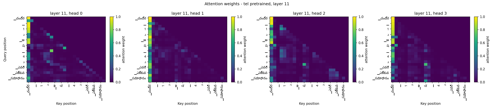


Every map is strictly lower-triangular with the upper triangle exactly zero,
which is a visual re-confirmation of the causal-mask property that
`scripts/19_sanity.py` verifies numerically. The **attention sink** documented in
Phase 2, a bright vertical stripe at key position 0 where heads with nothing
informative to attend to park their softmax mass, is present in both the
pretrained and finetuned late layers and is unchanged by finetuning. It is a
null operation, and the real structure is the fainter diagonal activity beside
it.

---

## 6. Bonus ablation: removing positional embeddings

### 6.1 Setup

The assignment's optional ablation asks for one language retrained with
positional embeddings removed, evaluated with the full Phase 2 suite. **Both
languages were run**, which gives a cross-check rather than a single data point.

`ModelConfig.use_positional_embeddings: false` makes `DecoderLM` skip
constructing the table entirely, the ablated model has no position parameters
to train, not zeroed ones.

Everything else is held fixed: same corpus, same tokenizer, same architecture,
same seed (1337), same schedule shape, same **fp16** precision as the standard
runs. The single difference is whether the model is told where each token sits.

| | Telugu standard | Telugu ablated | Nepali standard | Nepali ablated |
|---|---:|---:|---:|---:|
| Parameters | 24,562,944 | **24,366,336** | 24,906,624 | **24,710,016** |
| Positional embedding | 512 × 384 | **none** | 512 × 384 | **none** |
| Difference |, | **−196,608** (0.8%) |: | **−196,608** (0.8%) |
| Steps | 20,700 | 6,000 | 16,000 | 6,000 |
| Tokens seen | 1,356.6M | 393.2M | 1,048.6M | 393.2M |
| Wall clock | ~8.6 h | **205.9 min** | ~7.3 h | **175.5 min** |

The ablated runs were given 6,000 steps rather than the standard models' full
budget, for GPU-quota reasons. **That makes the final-checkpoint comparison
unequal, so the honest comparison is at a matched step**, which the pretraining
history makes possible.

### 6.2 The matched-step comparison: the number to quote

Both models evaluated at **step 6,000**, on the same validation split:

| | standard at step 6,000 | ablated at step 6,000 | cost of removing positions |
|---|---:|---:|---:|
| **Telugu** val loss | 3.8393 | **3.9330** | **+0.0937 nats** |
| Telugu val perplexity | 46.49 | **51.06** | **+9.8%** |
| **Nepali** val loss | 4.4071 | **4.5347** | **+0.1276 nats** |
| Nepali val perplexity | 82.03 | **93.20** | **+13.6%** |

**Removing positional embeddings costs less than 0.13 nats in both languages.**
That is a far smaller penalty than the textbook framing, "self-attention is
permutation invariant, so without positions the model cannot distinguish 'the dog
bit the man' from 'the man bit the dog'", would lead you to expect.

### 6.3 Why the penalty is so small

The permutation-invariance argument is correct about attention but incomplete
about the model. **The causal mask is itself positional information.** Position
*t* can attend to exactly *t*+1 keys, so the prefix length differs at every
position and the residual stream at position *t* is not interchangeable with the
one at position *t*′. What the model loses is not all order information, it is
the ability to say which of two *visible* tokens came first.

For next-token prediction that turns out to be a modest loss, because a large
share of the predictable signal is local n-gram statistics and bag-of-prefix
content, neither of which needs absolute positions. The 0.09–0.13 nat gap is a
reasonable estimate of what absolute ordering is actually worth here.

The gap is also **larger for Nepali (+0.128) than for Telugu (+0.094)**, despite
Nepali having fewer layers. Its 13.0 bytes per token means each position carries
more text, so losing the ability to order positions destroys proportionally more
structure.

### 6.4 Full Phase 2 evaluation suite on the ablated models

Final checkpoints. **The ablated models saw 6,000 steps against 20,700 and
16,000, so these differences mix the ablation with the shorter budget**, they
are reported for completeness, and read alongside
§6.2, which does not have that confound.

**Language modelling, test split**

| | Telugu standard | Telugu ablated | Nepali standard | Nepali ablated |
|---|---:|---:|---:|---:|
| Cross-entropy (nats) | 3.1843 | 3.5361 | 4.0838 | 4.4304 |
| Perplexity | 24.15 | 34.33 | 59.37 | 83.96 |
| **Bits per byte** | **0.4588** | **0.5095** | **0.4529** | **0.4913** |
| Change in BPB |, | **+11.0%** |: | **+8.5%** |

**Generation, greedy decoding**

| metric | Telugu standard | Telugu ablated | Nepali standard | Nepali ablated |
|---|---:|---:|---:|---:|
| BLEU-4 | 2.073 | 2.01 | 0.771 | 0.798 |
| chrF++ | 12.616 | 11.43 | 15.867 | 14.421 |
| ROUGE-L | 0.0496 | 0.0443 | 0.0621 | 0.0596 |
| Distinct-1 | 0.208 | 0.184 | 0.113 | 0.100 |
| Distinct-2 | 0.306 | 0.265 | 0.181 | 0.167 |
| **4-gram repetition** | 0.6283 | **0.6778** | 0.3964 | **0.5269** |

**Both languages lose about 9% of chrF++ while BLEU barely moves**: Telugu
12.62 to 11.43 and Nepali 15.87 to 14.42, against BLEU 2.07 to 2.01 and 0.77 to
0.80. chrF++ counts character n-grams and BLEU word n-grams, so removing
positions degrades character-level fidelity without changing how often whole
words coincide with the reference. The two languages agreeing this closely on
independently computed metrics is itself evidence the effect is real.

**The diagnostic that does show a clear effect is repetition.** Greedy 4-gram
repetition rises in both languages, Telugu 0.6283 → 0.6778, Nepali 0.3964 →
0.5269, a 33% relative increase. Distinct-1 and Distinct-2 fall in both. Without
positional information the model is measurably more prone to degenerate looping
under argmax decoding, which is intuitive: a model that cannot tell where it is
in the sequence has less to distinguish "I have already said this" from "I am
about to say this".

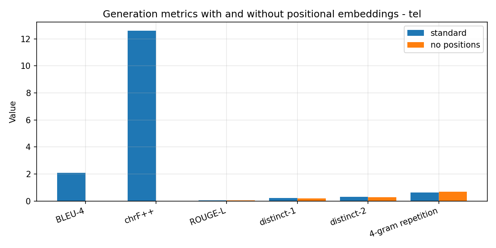

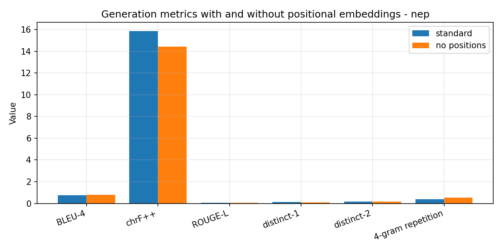

**Attention structure**

| | Telugu standard | Telugu ablated | Nepali standard | Nepali ablated |
|---|---:|---:|---:|---:|
| Mean entropy (nats) | 1.8547 | **2.2216** | 2.0100 | **2.1612** |
| Change |, | **+0.367** |: | **+0.151** |
| Mean distance (positions) | 11.033 | **9.109** | 9.204 | **8.452** |
| Change |, | **−1.925** |: | **−0.751** |

Maximum attainable entropy at this sequence length (48 tokens) is 2.9307 nats.

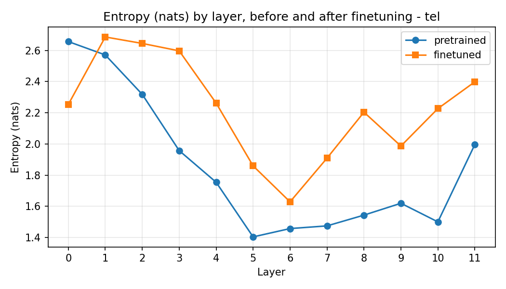

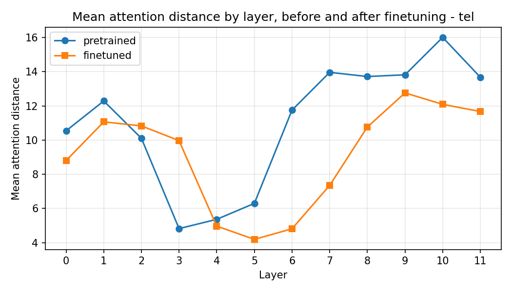

**This is the clearest structural result of the ablation.** Per-layer, Telugu:

| layer | standard entropy / distance | ablated entropy / distance |
|---:|---:|---:|
| 0 | 2.657 / 10.54 | 2.254 / 8.80 |
| 3 | **1.958 / 4.82** | 2.597 / 9.97 |
| 5 | **1.404 / 6.30** | 1.860 / 4.19 |
| 7 | 1.475 / 13.97 | 1.909 / 7.35 |
| 10 | 1.501 / **16.01** | 2.227 / **12.09** |
| 11 | 1.997 / 13.68 | 2.399 / 11.68 |

The standard model's clean three-stage organisation, diffuse aggregation at
layers 0–2, sharp local processing at 3–5, sharp long-range retrieval at 6–11,
**is visibly degraded**. The ablated model is more diffuse at nearly every layer
(+0.37 nats on average) and its long-range phase reaches 12.09 positions instead
of 16.01. Its sharpest layer moves from 5 to 6 and the local contraction that
Phase 2 found at layer 3 (distance 4.82) is gone entirely, layer 3 now sits at
9.97.

**What breaks without position information, in one paragraph.** The model retains
enough order signal from the causal mask to keep bits-per-byte within about 10%
and to produce well-formed orthography, so nothing catastrophic happens to
language modelling. What it loses is the ability to build *positionally
specific* attention operations. Phase 2 showed both standard models
independently learning a previous-token head with mean attention distance 1.11,
an operation that is definitionally positional. Without a position signal no such
head can exist, attention across the whole stack stays diffuse, the sharp
local-processing band disappears, and long-range retrieval reaches 25% less far.
Degenerate repetition under greedy decoding rises by a third. The ablation is
therefore not a story about capacity, 196,608 parameters is 0.8% of the model,
but about whether a particular *class* of attention head is representable at all.

---

## 7. Consolidated comparison: Model H against Model L

### 7.1 Everything in one table

| | Telugu (Model H) | Nepali (Model L) |
|---|---:|---:|
| **Corpus (Phase 1)** | | |
| Training tokens | 639,877,839 | 497,000,869 |
| Training documents | 1,097,873 | ~1.2M |
| Manually collected share | 15.26% | 8.34% |
| Bytes per token | 10.00 | 13.01 |
| Near-duplicate removal | exact + MinHash | **exact only** |
| **Tokenizer (Phase 1)** | | |
| Algorithm | SentencePiece unigram | SentencePiece unigram |
| Vocabulary | 8,000 | 32,000 |
| Unknown-token rate | 0.000000 | 0.000000 |
| **Model (Phase 2)** | | |
| Parameters | 24,562,944 | 24,906,624 |
| Layers × heads | 12 × 6 | 7 × 6 |
| Embedding share of parameters | 13.3% | **50.1%** |
| **Pretraining (Phase 2)** | | |
| Steps / epochs | 20,700 / 2.12 | 16,000 / 2.11 |
| Test perplexity | 24.15 | 59.37 |
| **Test bits per byte** | **0.4588** | **0.4529** |
| Greedy 4-gram repetition | 0.628 | 0.396 |
| **Reasoning (Phase 3)** | | |
| Finetuning best val loss | **0.6334** | 2.5762 |
| Exact match, finetuned | **40.00%** | 9.11% |
| Choice accuracy, finetuned | **41.75%** | 35.11% |
| Families above chance | 1 of 5 (`transitive_3`, +7.4) | **0 of 5** |
| Emits valid answer vocabulary | yes | **no** |
| **Ablation (Phase 3 bonus)** | | |
| Cost at matched step 6,000 | +0.094 nats (+9.8% ppl) | +0.128 nats (+13.6% ppl) |

### 7.2 Question 1: How did data scale and quality differ?

**Scale: a 22% gap, and it is the smaller part of the story.** Telugu reached
639.9M training tokens against Nepali's 497.0M. The manual share differed more,
15.26% against 8.34%, and both fell short of the 20% target. For Telugu that was
a deliberate sizing decision (holding the floor would have capped the corpus near
390M, well under the 500M target, and `scripts/07_finalize.py` relaxes the cap
only as far as reaching the target requires, never downsampling manual data). For
Nepali it was a collection failure: four of seven configured hosts produced
almost nothing, two returned HTTP 403 for robots.txt from datacenter IPs, one
exhausted link discovery early, one queued 52,045 URLs without fetching them,
and two of the largest available archives, `ekantipur.com` and `himalkhabar.com`,
were excluded by choice because they declare `Content-Signal: ai-train=no`.

**Quality: the gap is much larger than scale, and it is the decisive difference.**
Three concrete asymmetries:

1. **Language identification was nearly free for Telugu and genuinely hard for
   Nepali.** Telugu occupies an exclusive Unicode block (U+0C00–U+0C7F), so a
   script-ratio test settles the question. Nepali shares Devanagari with Hindi,
   Marathi, Maithili, Bhojpuri and Sanskrit, so it needed a three-gate ensemble:
   script ratio, GlotLID at a *lowered* 0.50 confidence threshold (because
   GlotLID is systematically less confident on genuine Nepali), a hard reject for
   confident Devanagari-neighbour votes, and a Nepali-versus-Hindi function-word
   discriminator to rescue the uncertain middle. That ensemble caught real
   contamination, 115 Maithili and 41 Hindi documents were rejected by the
   neighbour check, but a looser gate necessarily admits more.
2. **Deduplication was not equivalent.** Telugu received exact plus MinHash
   near-duplicate removal (5,446 exact, 64,072 near-duplicates). Nepali received
   **exact only**: a full MinHash pass completed its clustering, measuring 10,844
   exact and 38,218 near-duplicates across 1,151,127 clusters, but the Colab
   session died during the shard-writing pass and the output was lost. With the
   deadline close the corpus was rebuilt with the exact-only path. Roughly 3%
   near-duplicates therefore remain in the Nepali corpus.
3. **A substantial part of the Nepali corpus is word-level scrambled text.**
   Phase 2 found this by reading held-out reference continuations: real Nepali
   words in correct Devanagari that do not form sentences. It passes every
   Phase 1 filter legitimately, correct language, correct script, normal symbol
   ratio, and word-scrambling actually *reduces* n-gram repetition, so the
   repetition filters see it as *cleaner* than natural text. The likely cause is
   one downloaded source being a token-level rather than document-level dataset;
   `nepalitext` and `indiccorp_v2` are the candidates.

### 7.3 Question 2: How do language-modelling and reasoning results compare?

**They point in opposite directions, and that contrast is the central finding of
the whole project.**

**On language modelling the two models are at parity.** Perplexity says Model H
is 2.5× better (24.15 against 59.37), but perplexity is per *token* and a token
is not the same object in the two models: Telugu's 8,000-piece vocabulary packs
10.0 bytes into a token, Nepali's 32,000-piece vocabulary packs 13.0. Each Nepali
prediction covers more text and chooses from four times as many options, so its
perplexity is inflated by construction. Bits-per-byte normalises by the
underlying UTF-8 text, and on it **Model L is 1.3% ahead, 0.4529 against
0.4588**, despite 22% less data, half the manual share, 7 layers against 12, and
half its parameters locked in its embedding.

**On reasoning the gap is wide and favours Model H.** Exact match 40.00% against
9.11%; choice accuracy 41.75% against 35.11%; one family above chance against
none; best finetuning validation loss 0.6334 against 2.5762.

**Why the divergence?** The two tasks probe different things. Bits-per-byte
rewards predicting the *next* token of whatever distribution the model was
trained on, and if part of that distribution is word salad, a model that
predicts word salad well still scores well. Reasoning requires producing a
*specific short answer from a constrained vocabulary in a structured format*,
which demands that the model has learned what a well-formed Nepali noun looks
like as a complete unit. Model L's outputs (`िनी`, `ियाको`, 15 empty strings)
show it has not.

**This is the strongest available evidence that the Nepali corpus problem is
real and consequential rather than a curiosity.** Phase 2 could document the
scrambled text but could not show that it *mattered*, because bits-per-byte is
partly blind to it. Phase 3 shows what it costs.

### 7.4 Question 3: Which tokenizer and corpus factors most affected Model L?

**In order of impact.**

**1. Corpus destructuring: the largest single factor.** Word-level scrambled
text destroys exactly what a reasoning task needs: the association between a
complete word form and its role in a sentence. A model trained partly on shuffled
words learns which words co-occur but not how to emit one cleanly bounded noun as
an answer. The fragment outputs in §4.4 are the direct behavioural signature.

**2. The 32,000-piece vocabulary, through the architecture.** At `d_model=384` a
32,000-piece embedding costs 12.29M parameters against Telugu's 3.07M. Against a
~25M budget that left 12.4M for transformer blocks, **7 layers instead of 12**.
Model L traded five transformer layers for vocabulary coverage. Phase 2's
attention analysis showed exactly what that buys and costs: the same three-stage
organisation compressed into 7 layers, with a long-range phase two layers deep
instead of six and a maximum attention distance of 12.43 against 16.01. §5.2
shows the same compression under finetuning stress, where Nepali's middle band
reorganises about twice as violently as Telugu's.

Without weight tying Model L could not have been built at this budget at all,
an untied 7-layer Nepali model needs about 37.2M parameters.

**3. Incomplete deduplication.** ~3% residual near-duplicates inflate the
effective epoch count on repeated material and waste a share of a corpus that was
already the smaller of the two.

**4. Language-identification precision.** The gates Nepali needs are necessarily
looser than Telugu's. Precision was traded for recall deliberately, the
low-resource principle that every filter costs data you cannot replace, but the
trade admits more near-miss material.

**One factor that turned out *not* to matter much: raw token count.** The 22%
data gap barely registers in the bits-per-byte comparison, because both models
were compute-limited rather than data-limited, both loss curves were still
descending when their cosine schedules ended, and neither showed meaningful
overfitting at ~2.1 epochs.

### 7.5 Question 4: What evidence explains the observed differences?

Ranked by how directly each piece bears on the conclusion.

**Direct behavioural evidence: the prediction distributions (§4.4).** Telugu
emits 28 distinct outputs, all valid whole entity names from the correct test
pool, with 1 empty. Nepali emits 36, including `िनी` 827 times (a word-internal
suffix piece), `कप` 380 times (an object from the *training* pool, never a legal
test answer), and 15 empty strings. **This is not a reasoning difference, it is a
lexical competence difference**, and it is the single most informative artefact
produced in Phase 3.

**Direct evidence: the finetuning loss curves (§2.2).** Telugu reaches 0.6334
validation loss on the task, Nepali 2.5762, a factor of four on identical data,
identical hyperparameters and identical example counts (22,000 examples, 691,133
against 735,472 tokens). The task is the same; the models' ability to fit it is
not.

**Corroborating evidence: the Phase 2 held-out samples.** The Nepali reference
continuations drawn from the held-out split are not coherent prose:
`पर्यो दिगो भाई महामारीको थियौं भारतबाटसम् चुनावी अवधारणा संस्थाले' रुपमा लेख्न पनी …`
Real Nepali words in correct orthography that do not form sentences. The
equivalent Telugu references are running prose.

**Corroborating evidence: the attention reorganisation (§5).** Under identical
finetuning pressure Telugu's attention contracts (−0.22 positions, 50 of 72 heads
more local) while Nepali's expands (+0.55 positions, 29 of 42 heads more
long-range), with individual head changes roughly twice the magnitude. Consistent
with a model that must search the input rather than compose it.

**Structural evidence: the ablation (§6).** Removing positional embeddings costs
Nepali more than Telugu (+0.128 against +0.094 nats at matched step), consistent
with each Nepali token carrying 30% more text so that losing ordering destroys
proportionally more structure.

**Evidence that constrains the conclusion.** Bits-per-byte parity (0.4529 against
0.4588) means Model L is *not* simply a worse language model. Whatever is wrong
is specific to producing structured, lexically well-formed short answers. And the
direction of the scrambled-text bias cannot be settled from these measurements:
word-shuffled text destroys long-range structure, which ought to make it *harder*
to model, not easier, so the naive expectation is that it hurts Nepali's
bits-per-byte rather than flattering it. That uncertainty is attached to the
parity claim and not resolved here.

---

## 8. Limitations

Stated plainly, because several of them qualify the results above.

1. **The reasoning result is largely negative.** Neither model learned
   comparative reasoning. Model H is within 1–4 points of chance on four of five
   families; Model L is at or below chance on all five. The single positive
   signal is `transitive_3` choice accuracy at +7.4 points over chance. The
   honest summary is that finetuning taught the output format, not the task.
2. **Finetuning was badly over-budgeted.** Both models peaked at step 100 of
   1,500. The best-checkpoint mechanism saved the correct model, so the reported
   numbers are right, but a proper sweep around 25–200 steps was never run and
   might have found a better optimum.
4. **The ablation ran 6,000 steps against 20,700 and 16,000.** §6.2 handles this
   with a matched-step comparison from the recorded histories; §6.4's
   final-checkpoint table does not, and says so.
5. **Nepali never received MinHash deduplication** (Phase 1), so ~3%
   near-duplicates remain.
6. **The Nepali corpus contains word-level scrambled text** that no Phase 1
   filter caught. Identifying and dropping the offending source is the single
   highest-value fix available and would change Model L's numbers more than any
   architectural change.
7. **The reasoning templates were written by a non-speaker.** The phrasing is
   isolated in two YAML files so a native speaker can correct it without touching
   code, but that review has not happened.
8. **Attention comparisons rest on 16 prompts.** The aggregate statistics are
   stable and the directions are consistent across layers, but this is not a
   mechanistic account of any individual head.
9. **`report/phase1_report.md` describes the first Phase 1 run** (564.0M tokens,
   16,000-piece Telugu vocabulary) rather than the re-run that Phase 2 and 3
   actually used (639.9M, 8,000). The methodology in it is accurate; the counts
   are one run old. Re-running `scripts/12_package.py` against the final work
   directory would regenerate it.

## 9. What I would do differently

1. **Find and drop the scrambled Nepali source.** Read raw documents from
   `5_final` grouped by source; if whole documents from one source are word
   salad, remove it from `nepali/configs/sources.yaml` and re-run Phase 1 for
   that language. Everything else is downstream of this.
2. **Finetune for 200 steps, evaluating every 25.** Both models peaked at 100.
3. **Scale the reasoning dataset up and the template count with it.** 22,000
   examples over 5 families with 34 training entities is small enough that a 25M
   model memorises it in one pass. More entities, more attributes and more
   phrasings per family would force generalisation rather than recall.
4. **Reconsider Telugu's 8,000-piece vocabulary.** The selection rule takes the
   smallest vocabulary within 5% of the best characters-per-token, which pushed
   below the assignment's suggested range. 16,000 would make the two models more
   comparable and would likely reduce Telugu's greedy repetition.
5. **Train longer.** Both pretraining curves were still descending when their
   schedules ended; the session limit, not the data or the architecture, stopped
   them.
6. **Use rotary positional embeddings**, removing the hard 512-token ceiling that
   learned absolute embeddings impose, and, per §6, giving the model a relative
   ordering signal that the ablation shows is genuinely load-bearing for
   attention structure.

---

## 10. Deliverables

| # | required | where |
|---|---|---|
| 1 | Reasoning data generation scripts, finetune scripts, configs | `common/reasoning/generate.py`, `common/reasoning/data.py`, `common/reasoning/evaluate.py`, `scripts/30_make_reasoning.py`, `scripts/31_finetune.py`, `*/configs/reasoning.yaml`, `*/configs/finetune.yaml` |
| 2 | Finetuned checkpoints (H and L) via Drive links | see README |
| 3 | Finetuning logs, metrics, qualitative examples | `telugu/logs/`, `nepali/logs/`, `report/tables/finetune_*.json`, `report/tables/reasoning_samples_*.json` |
| 4 | Pretrain vs finetune attention comparison | §5; `scripts/33_attention_compare.py`; `report/tables/attention_compare_*.json`; `figures/reasoning_attention_*`, `figures/attention_shift_*` |
| 5 | Final comparison tables and error analysis | §4.2–4.5, §7 |
| 6 | Complete final report and reproducibility instructions | this document; §11 and the README |
|, | Bonus: no-positional-embedding ablation | §6; `scripts/34_ablation.py`; `*/configs/model_nopos.yaml`; `report/tables/ablation_*.json` |

Every figure carries a title, both axis labels and a legend. Computation lives in
`common/eval/` and `common/reasoning/`; plotting is confined to `common/viz.py`.

## 11. Reproducing Phase 3

```bash
python scripts/30_make_reasoning.py   --lang tel   # generate + verify leakage
python scripts/31_finetune.py         --lang tel   # finetune, resumable
python scripts/32_eval_reasoning.py   --lang tel   # pretrained vs finetuned
python scripts/33_attention_compare.py --lang tel  # attention before/after
python scripts/34_ablation.py         --lang tel   # bonus, optional
python scripts/35_final_report.py                  # assemble the tables
```

or `python scripts/run_phase3.py --lang tel` for stages 30–33 in order, and
`--ablation` to add stage 34.

The dataset generator is seeded, so stage 30 reproduces byte for byte.
Finetuning and the ablation are resumable: re-running after an interrupted
session continues from the last checkpoint.

Phase 3 needs the Phase 1 tokenizers and the Phase 2 checkpoints in the work
directory. The ablation additionally needs the tokenized arrays
(`{work}/{language}/6_tokenized/{train,val,test}.bin` and `token_report.json`).
On Kaggle, `scripts/kaggle_phase3.py` fetches everything from Drive, verifies
that each tokenizer matches the checkpoint it will be used with, and runs the
whole phase in one command.
