# Phase 2 — Model Implementation, Pretraining and Evaluation

Two decoder-only transformers, written from primitive PyTorch layers and trained
independently on the Phase 1 corpora. Neither model was initialised from the
other; they share no weights, no vocabulary, no data and no training run.

Both models are trained and evaluated. Model H is Telugu, Model L is Nepali.

| | Telugu (H) | Nepali (L) |
|---|---:|---:|
| Parameters | 24,562,944 | 24,906,624 |
| Vocabulary | 8,000 | 32,000 |
| Layers | 12 | 7 |
| Corpus | 639,877,839 tokens | 497,000,869 tokens |
| Manual share | 15.26% | 8.34% |
| Training steps | 20,700 | 16,000 |
| Tokens seen | 1,356.6M (2.12 epochs) | 1,048.6M (2.11 epochs) |
| **Test perplexity** | **24.15** | **59.37** |
| **Test bits/byte** | **0.4588** | **0.4529** |

---

## 1. Architecture

### 1.1 The forward pass, in order

```
token ids (B, T)
  → token embedding          (B, T, d)     nn.Embedding(V, d)
  + positional embedding     (B, T, d)     nn.Embedding(T_max, d)
  → dropout
  → N × TransformerBlock
        x = x + Attention(LayerNorm(x))
        x = x + FeedForward(LayerNorm(x))
  → final LayerNorm
  → linear projection to vocabulary, tied to the input embedding
  → cross-entropy against the next token
```

Everything is in `common/model/`: `attention.py`, `block.py`, `transformer.py`,
`config.py`. There is no `nn.Transformer`, no `nn.MultiheadAttention`, and no
`F.scaled_dot_product_attention` anywhere in the model path: only `nn.Linear`,
`nn.Embedding`, `nn.LayerNorm`, `nn.Dropout` and explicit tensor operations.

### 1.2 Multi-head causal self-attention

With `B` batch, `T` sequence length, `d` model dimension, `h` heads and
`d_head = d/h`:

| step | operation | shape |
|---|---|---|
| project | `Q = XW_Q`, `K = XW_K`, `V = XW_V` | `(B, T, d)` |
| split heads | `view(B, T, h, d_head).transpose(1, 2)` | `(B, h, T, d_head)` |
| score | `Q @ K.transpose(-2,-1) / sqrt(d_head)` | `(B, h, T, T)` |
| mask | `masked_fill(upper_triangle, -inf)` | `(B, h, T, T)` |
| normalise | `softmax(dim=-1)` | `(B, h, T, T)` |
| attend | `weights @ V` | `(B, h, T, d_head)` |
| merge heads | `transpose(1,2).contiguous().view(B, T, d)` | `(B, T, d)` |
| project out | `W_O` | `(B, T, d)` |

The reshape-then-transpose is what makes the head axis batchable: after it, the
score matmul runs independently per head. `contiguous()` before the second
`view` is not optional, because `transpose` only rewrites strides and `view` needs a
contiguous buffer.

**Why `1/√d_head`.** A raw dot product `q·k` sums `d_head` products of
roughly unit-variance terms, so its variance grows linearly with `d_head`,
which here is 64. Feeding scores of that magnitude into softmax saturates it: one weight
goes to ~1, the rest to ~0, and the gradient through the softmax vanishes.
Dividing by `√d_head` holds the score variance near 1 regardless of head width.

**The causal mask** is built in the module, not imported: an upper-triangular
boolean registered as a non-persistent buffer, used with `masked_fill(..., -inf)`
before the softmax so masked positions receive exactly zero weight afterwards.
It is sliced to `[:T, :T]` so shorter sequences work unchanged.

### 1.3 The rest of the block

**Feed-forward.** `d → 4d → d` with GELU between. Position-wise, meaning the
same weights apply at every position independently. Attention is the *only*
place information moves along the sequence. The 4× inner width is where most of
the model's pattern-storage capacity sits; in this model the feed-forward layers
hold 1.18M of each block's 1.77M parameters.

**Residuals and normalisation.** Pre-norm: `x = x + Sublayer(LayerNorm(x))`.
This leaves an unbroken identity path from the first layer to the last, so
gradients reach early layers without passing through a normalisation at every
step. Post-norm, `x = LayerNorm(x + Sublayer(x))`, is the original
formulation and is implemented too (`norm_first: false`), but it needs a more
carefully tuned warmup to stay stable at this depth. With 12 layers, pre-norm
was the safer default and the run showed no instability.

**Output head and weight tying.** The output projection reuses the input
embedding matrix. At `V=8,000` and `d=384` that saves **3,072,000 parameters**,
12.5% of the model, and ties a token's representation as input to its
representation as a prediction target, which is a reasonable prior and
consistently helps at this scale.

**Initialisation.** Normal(0, 0.02) throughout, with the two residual output
projections (`W_O` and `fc_out`) also scaled by `1/√(2N)`. Each layer
adds two residual contributions, so without that scaling the variance of the
residual stream grows with depth.

### 1.4 Positional information

**Learned absolute embeddings**: a second embedding table indexed by position,
added to the token embedding. Self-attention is permutation invariant, so without
positions the model cannot distinguish "the dog bit the man" from "the man bit
the dog".

The cost is a hard ceiling. There is no embedding row beyond `max_seq_len`, so
this model **cannot process more than 512 tokens of context**, and the window
cannot be extended after training without adding and training new rows.
Sinusoidal encodings would extrapolate to unseen positions, and rotary
embeddings would too while also making relative distance explicit in the
attention scores. Learned absolute was chosen because it is the simplest thing
to explain end to end, and the context length is fixed for this project. The
model raises an explicit error rather than silently truncating if handed a
longer sequence.

### 1.5 Configuration and parameter count

`telugu/configs/model.yaml`, reproduced verbatim in
`telugu/logs/config_tel.yaml` as saved beside the checkpoint:

| | |
|---|---|
| Vocabulary | 8,000 (Phase 1 unigram tokenizer) |
| `d_model` | 384 |
| Layers | 12 |
| Heads | 6 (`d_head` = 64) |
| Feed-forward width | 1,536 (4 × `d_model`) |
| Context length | 512 |
| Dropout | 0.1 (embeddings, attention, sublayer outputs) |
| Normalisation | pre-norm |
| Embeddings tied | yes |

| component | parameters | share |
|---|---:|---:|
| Token embedding (8,000 × 384) | 3,072,000 | 12.5% |
| Positional embedding (512 × 384) | 196,608 | 0.8% |
| 12 transformer blocks | 21,293,568 | 86.7% |
| Final LayerNorm | 768 | 0.0% |
| Output head | 0 (tied) | — |
| **Total trainable** | **24,562,944** | |

For Nepali (`nepali/configs/model.yaml`, saved as `nepali/logs/config_nep.yaml`)
everything is identical except depth:

| component | parameters | share |
|---|---:|---:|
| Token embedding (32,000 × 384) | 12,288,000 | 49.3% |
| Positional embedding (512 × 384) | 196,608 | 0.8% |
| 7 transformer blocks | 12,421,248 | 49.9% |
| Final LayerNorm | 768 | 0.0% |
| Output head | 0 (tied) | — |
| **Total trainable** | **24,906,624** | |

The two models are within **1.4%** of each other on parameter count and identical
in width, head count, feed-forward ratio, context length, dropout and
normalisation. Depth is the only architectural difference, and it exists purely
to absorb the vocabulary gap.

The consequence is worth stating plainly, because it drives most of §8: the
embedding is **13.3%** of Model H and **50.1%** of Model L. Half of the Nepali
model's parameters are spent representing its vocabulary before any computation
happens, leaving 7 layers of transformer against Telugu's 12. Tying the output
head saves 3.07M parameters for Telugu and **12.29M** for Nepali; without it,
Model L could not have been built at this budget at all.

`scripts/19_sanity.py` checks the measured count against the arithmetic derived
from the config, so a config change cannot leave a stale number in this report.

### 1.6 The depth/width trade-off

The width and head count were fixed at `d_model=384`, 6 heads for **both**
languages, and only depth was allowed to vary. That is deliberate: Nepali's
32,000-piece vocabulary costs 12.3M parameters in the embedding against Telugu's
3.1M, and if width were also free the two models would differ in three ways at
once and the H-versus-L comparison would be uninterpretable. Letting depth
absorb the vocabulary difference leaves exactly one architectural variable.

Within that constraint the depth follows from the ~25M budget:
`(25M − embedding) / 1,774,464 parameters per block`. For Telugu's small
vocabulary that is 12 layers; for Nepali's large one, 7.

Depth rather than width was also the right way to spend the surplus. At a fixed
parameter count, a deeper-narrower stack gives more sequential composition
steps, and next-token prediction over a morphologically rich language benefits
from composition depth more than from wider individual layers. The cost is
proportionally more sequential work per step and a slightly higher risk of
optimisation trouble, which the pre-norm formulation and the `1/√(2N)`
residual scaling are there to control, and which did not materialise.

---

## 2. Pre-training verification

Three checks run before any GPU time is committed (`scripts/19_sanity.py`).
Each catches a class of bug that is otherwise invisible until a loss curve
looks subtly wrong.

### 2.1 Loss before training equals ln(V)

At initialisation the logits carry no information, so the softmax is
near-uniform and every token has probability ≈ 1/V. Cross-entropy is then
−ln(1/V) = ln(V).

| | Telugu | Nepali |
|---|---:|---:|
| Observed | 9.0796 | 10.4386 |
| Expected, ln(V) | 8.9872 | 10.3735 |
| Ratio | **1.0103** | **1.0063** |

A materially different starting loss would mean the initialisation scale, the
loss reduction, or the target alignment is wrong.

### 2.2 The causal mask holds

The token at position `t+1` is altered and the logits are compared:

| | Telugu | Nepali |
|---|---:|---:|
| Max logit change at positions ≤ t | **0.000e+00** | **0.000e+00** |
| Max logit change at positions > t | 1.254e+00 | 1.213e+00 |

Exactly zero before the perturbation, so no position can see ahead; non-zero at
and after it, which confirms the perturbation was real rather than the test
being vacuous. This runs in `eval()` mode. With dropout active the two forward
passes differ by random masking alone and the test measures noise instead of
information flow. That mistake produced a false "NOT CAUSAL" on the first run.

### 2.3 Targets are aligned

A small model is trained for 300 steps on a sequence whose next token is a
deterministic function of the current one (`0, 1, 2, …`), then asked to predict:

```
input      [0, 1, 2, 3, 4, 5]
predicted  [1, 2, 3, 4, 5, 6]
loss 0.0028, next-token accuracy 1.000
```

Both models pass identically. This check exists because it caught a real bug. The data layer already returns
targets shifted by one, and an earlier version of `forward()` shifted *again*,
training the model to predict two tokens ahead. Nothing else would have caught
it: both alignments start at exactly ln(V) and both train downward.

---

## 3. Pre-training

### 3.1 Setup

| | |
|---|---|
| Optimiser | AdamW, β = (0.9, 0.95), ε = 1e-8 |
| Weight decay | 0.1 on tensors of ≥2 dimensions only |
| Learning rate | 3e-4 peak, 3e-5 floor |
| Schedule | 500 steps linear warmup, then cosine decay |
| Gradient clipping | global norm 1.0, applied after unscaling |
| Batch | 16 sequences × 8 accumulation steps × 512 tokens = **65,536 tokens/step** |
| Precision | fp16 with `GradScaler` |
| Hardware | one Tesla T4 (Kaggle) |
| Seed | 1337 |

| | Telugu (H) | Nepali (L) |
|---|---:|---:|
| Steps | 20,700 | 16,000 |
| Tokens seen | 1,356.6M | 1,048.6M |
| Epochs of its corpus | **2.12** | **2.11** |
| Wall clock | ~8.6 h | 7.3 h |
| Seconds per step | 1.39 | 0.99 |

The epoch counts were matched deliberately. Nepali's measured step time would
have allowed 27,200 steps in the same budget, 3.59 epochs, but training the two
models on very different numbers of passes over their data would confound §8:
a gap could then come from the languages, the corpora, *or* simply from one model
seeing its data 70% more often. Matching at ~2.11 epochs removes that variable.
Nepali is faster per step despite the same parameter count because 7 layers of
attention cost less than 12, even when the embedding makes up the difference.

Weight decay is applied only to matrices. Decaying LayerNorm gains, biases and
embeddings pulls parameters that have no business shrinking toward zero.

Warmup exists because AdamW's second-moment estimate is poorly scaled for the
first few hundred steps; starting at the full rate there is the usual cause of
an early loss spike. None occurred here.

**On precision:** `auto` selected bfloat16, which ran at **5.1 s/step**. The T4
is Turing and has no bf16 tensor cores, so bf16 is emulated at roughly fp32
speed. Forcing fp16 gave **1.39 s/step, 3.7× faster**, and made the difference
between 0.6 and 2.1 epochs within the same session budget. Gradient norms stayed
between 0.5 and 0.6 for the whole run with no scaler collapse or non-finite
losses, so the narrower fp16 dynamic range cost nothing here.

### 3.2 Checkpointing

Every checkpoint carries model weights, optimizer state, `GradScaler` state, the
step counter, the best validation loss so far, the full history and both configs.
Written to a temporary file and renamed, so a session dying mid-write leaves the
previous checkpoint intact rather than a truncated one.

This was not theoretical. The Kaggle session died **twice** during this run, at
step 6,560 and again at 19,600, both times from a browser refresh killing the
interactive session. Both times training resumed from the last checkpoint with
at most 600 steps lost. Without resumable checkpoints the run would have had to
start over from zero, twice.

### 3.3 The loss curve

**Telugu (Model H)**

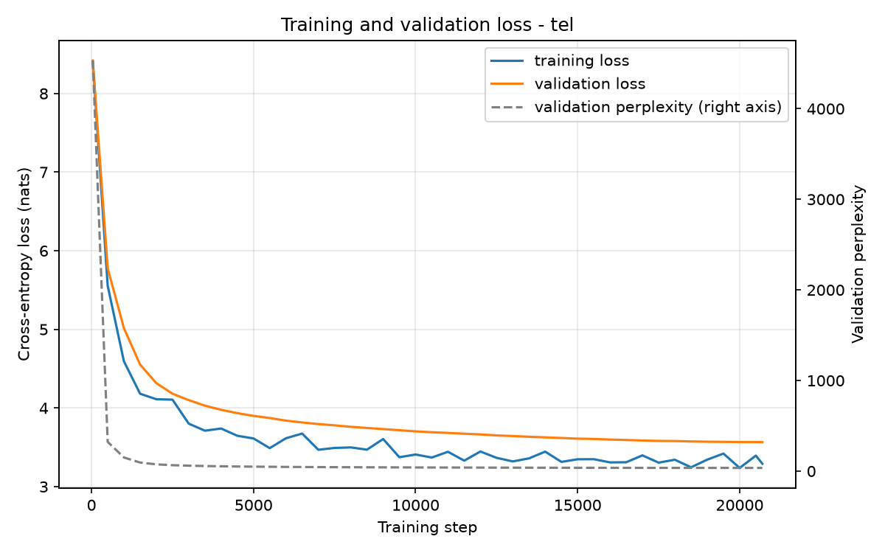

**Nepali (Model L)**

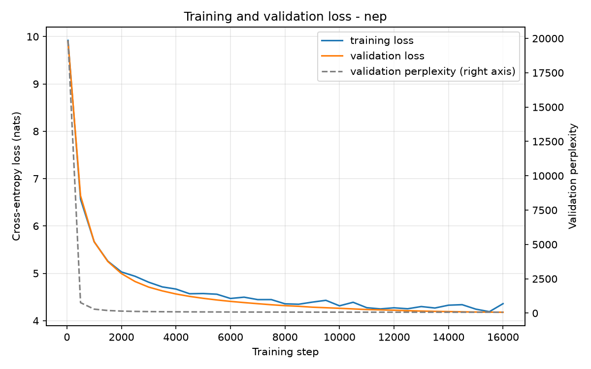

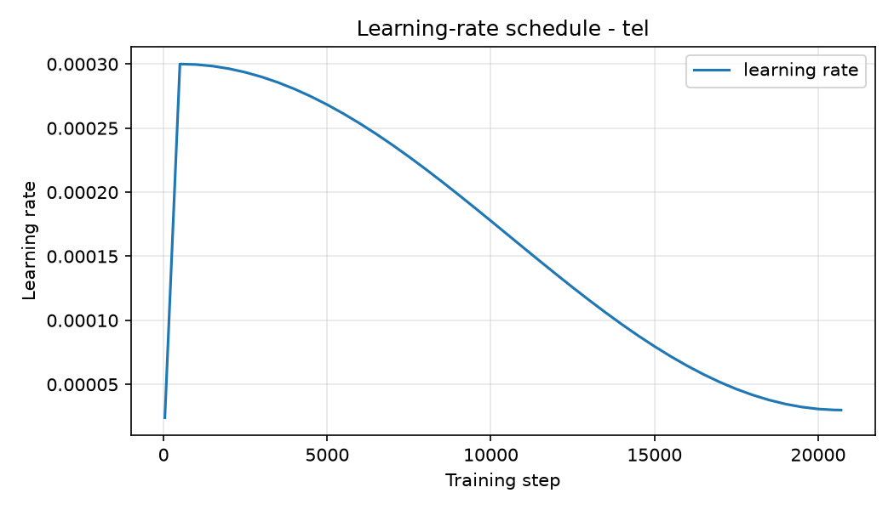

| step | tokens | train loss | val loss | val perplexity | lr |
|---:|---:|---:|---:|---:|---:|
| 40 | 3M | 8.4061 | 8.4188 | 4531.35 | 2.4e-05 |
| 500 | 33M | 5.5540 | 5.7764 | 322.60 | 3.0e-04 |
| 1,000 | 66M | 4.5942 | 5.0161 | 150.82 | 3.0e-04 |
| 2,000 | 131M | 4.1115 | 4.3163 | 74.91 | 2.96e-04 |
| 4,000 | 262M | 3.7391 | 3.9770 | 53.36 | 2.80e-04 |
| 6,000 | 393M | 3.6151 | 3.8393 | 46.49 | 2.54e-04 |
| 8,000 | 524M | 3.4988 | 3.7606 | 42.98 | 2.18e-04 |
| 10,000 | 655M | 3.4084 | 3.7026 | 40.55 | 1.78e-04 |
| 12,000 | 786M | 3.4467 | 3.6636 | 39.00 | 1.36e-04 |
| 14,000 | 918M | 3.4451 | 3.6263 | 37.57 | 9.69e-05 |
| 16,000 | 1,049M | 3.3082 | 3.5988 | 36.55 | 6.45e-05 |
| 18,000 | 1,180M | 3.3421 | 3.5795 | 35.86 | 4.17e-05 |
| 20,700 | 1,357M | 3.2917 | 3.5653 | 35.35 | 3.00e-05 |

Nepali, over 16,000 steps:

| step | tokens | train loss | val loss | val perplexity | lr |
|---:|---:|---:|---:|---:|---:|
| 40 | 3M | 9.9190 | 9.8961 | 19853.55 | 2.4e-05 |
| 500 | 33M | 6.5640 | 6.6374 | 763.11 | 3.0e-04 |
| 1,000 | 66M | 5.6657 | 5.6671 | 289.20 | 2.99e-04 |
| 2,000 | 131M | 5.0288 | 4.9946 | 147.62 | 2.94e-04 |
| 4,000 | 262M | 4.6677 | 4.5635 | 95.92 | 2.67e-04 |
| 6,000 | 393M | 4.4687 | 4.4071 | 82.03 | 2.24e-04 |
| 8,000 | 524M | 4.3557 | 4.3170 | 74.96 | 1.72e-04 |
| 10,000 | 655M | 4.3136 | 4.2613 | 70.90 | 1.18e-04 |
| 12,000 | 786M | 4.2716 | 4.2210 | 68.10 | 7.20e-05 |
| 14,000 | 918M | 4.3269 | 4.1917 | 66.13 | 4.10e-05 |
| 16,000 | 1,049M | 4.3589 | 4.1781 | 65.24 | 3.00e-05 |

The shape is unremarkable in the best sense: a steep fall through warmup, a knee
around step 2,000, then a long slow decline tracking the cosine decay. Training
and validation stay close throughout, with a gap at the end of 0.27 nats, so
there is no meaningful overfitting even at 2.1 epochs. The curve was still
descending when the schedule ended, which says the model was compute-limited
rather than data-limited.

Nepali's curve has the same shape but sits ~0.6 nats higher throughout, and its
train and validation losses **cross** near the end: training loss 4.3589 against
validation 4.1781 at step 16,000. Training loss above validation loss is unusual
but not alarming: the training figure is a single noisy 65,536-token step while
validation averages 50 batches, and dropout is active for training and disabled
for evaluation. It indicates the model is nowhere near memorising this corpus.

**One caveat about these numbers.** The in-training validation scores only 50
batches, about 409k of 9.3M validation tokens, for speed. Because shards are
written in source order, that prefix is not representative of the split. The
authoritative figures are in §4, computed over the entire split; they are
**better** than the in-training numbers (23.93 against 35.35), not worse.

---

## 4. Language-modelling results

Computed over the complete splits by `scripts/21_evaluate.py`, from each model's
best checkpoint.

| | Telugu val | Telugu test | Nepali val | Nepali test |
|---|---:|---:|---:|---:|
| Cross-entropy (nats/token) | 3.1753 | 3.1843 | 4.0961 | 4.0838 |
| **Perplexity** | 23.93 | **24.15** | 60.11 | **59.37** |
| **Bits per byte** | 0.4579 | **0.4588** | 0.4541 | **0.4529** |
| Tokens scored | 9,318,912 | 9,540,608 | 7,209,984 | 7,044,096 |
| Bytes of text | 93,224,232 | 95,534,676 | 93,836,756 | 91,635,309 |
| Bytes per token | 10.004 | 10.013 | 13.015 | 13.009 |

Validation and test agree to within 0.01 nats for both models. The splits were
carved out before cleaning and decontaminated against training, so neither is
contaminated and neither is anomalous.

### 4.1 Why perplexity and bits-per-byte disagree

This is the single most important number in the report, and it points the
opposite way to the obvious reading.

**By perplexity, Model H looks 2.5× better**: 24.15 against 59.37.

**By bits-per-byte, Model L is slightly ahead**: 0.4529 against 0.4588, a 1.3%
edge to Nepali.

Both are correct, and the second is the one that means anything. Perplexity is
per *token*, and a token is not the same object in the two models. Telugu's
8,000-piece vocabulary packs 10.0 bytes into a token; Nepali's 32,000-piece
vocabulary packs 13.0. Each Nepali prediction is therefore a harder problem:
more text to get right, chosen from four times as many options, so its
per-token perplexity is inflated by construction. Comparing 24.15 to 59.37
measures the tokenizers, not the models.

Bits-per-byte, computed as `cross_entropy_nats × tokens × log₂(e) / bytes`,
normalises by the underlying UTF-8 text. That unit is identical across the two
languages, and on it the two models are within 1.3% of each other.

The practical consequence for Model L is that it achieves parity on the fair
measure despite 22% less data (497.0M against 639.9M tokens), a lower manual
share (8.34% against 15.26%), and 7 transformer layers against 12. That is not
what the resource gap would predict, and §8 takes it apart.

## 5. Generation quality

200 prefixes of 64 tokens sampled from the held-out split, each continued for 64
tokens under four decoding settings, scored against the true continuation.

| decoding | BLEU-4 | chrF++ | ROUGE-L | Distinct-1 | Distinct-2 | 4-gram repetition | mean words |
|---|---:|---:|---:|---:|---:|---:|---:|
| greedy | 2.07 | 12.62 | 0.0496 | 0.208 | 0.306 | **0.628** | 28.2 |
| T = 0.5 | **2.51** | 15.41 | **0.0564** | 0.396 | 0.652 | 0.215 | 27.9 |
| T = 1.0 | 1.88 | **18.23** | 0.0403 | 0.713 | 0.987 | 0.0002 | 30.9 |
| T = 1.5 | 0.98 | 16.93 | 0.0161 | 0.759 | 0.999 | 0.0000 | 35.8 |

Nepali, same protocol:

| decoding | BLEU-4 | chrF++ | ROUGE-L | Distinct-1 | Distinct-2 | 4-gram repetition | mean words |
|---|---:|---:|---:|---:|---:|---:|---:|
| greedy | 0.77 | 15.87 | 0.0621 | 0.113 | 0.181 | **0.396** | 50.7 |
| T = 0.5 | **1.01** | 17.83 | **0.0707** | 0.300 | 0.618 | 0.123 | 49.0 |
| T = 1.0 | 0.72 | **19.22** | 0.0618 | 0.533 | 0.947 | 0.0027 | 51.9 |
| T = 1.5 | 0.08 | 17.45 | 0.0280 | 0.684 | 0.997 | 0.0000 | 52.9 |

BLEU is corpus-level BLEU-4 via sacreBLEU with international tokenisation.
Telugu greedy signature: `12.0/2.7/1.1/0.6 (BP = 0.970, hyp_len 7201, ref_len
7419)`; Nepali: `7.5/1.3/0.3/0.1 (BP = 0.969, hyp_len 10270, ref_len 10598)`.
So 12% of Telugu unigrams match the reference against 7.5% of Nepali's, and both
collapse to well under 1% by 4-grams.

Both models show the **same ordering**: BLEU and ROUGE-L peak at T = 0.5,
chrF++ peaks at T = 1.0, repetition falls monotonically with temperature. That
the pattern reproduces across two independent models, languages, corpora and
tokenizers is decent evidence it is a property of the metrics rather than an
accident of one run.

### 5.1 What these metrics do and don't tell you

**All three overlap metrics are close to uninformative here, and it is worth
being precise about why.** BLEU, chrF++ and ROUGE-L each compare a generated
continuation against *one* reference continuation. Language modelling is
open-ended: given 64 tokens about a legal dispute, there are thousands of fluent,
factually reasonable continuations, and the one that happened to appear in the
corpus is just one sample. A model can produce excellent Telugu and score near
zero. The absolute values here should not be read as generation quality.

They are reported because **relative**
comparison across decoding settings for a single model is still meaningful, since the
reference is held constant, so differences reflect the decoding, not the metric's
blindness.

**BLEU and chrF++ disagree, and the disagreement is the interesting part.** BLEU
peaks at T=0.5 (2.51) while chrF++ peaks at T=1.0 (18.23). BLEU counts exact word
n-gram matches, so it rewards conservative decoding that reproduces common
phrasings verbatim. chrF++ works on character n-grams, so a correct stem with a
different case ending still earns most of its credit. Telugu is agglutinative:
one wrong suffix destroys a word-level match while leaving most characters
intact. **chrF++ is the more informative of the two for this language**, and its
ranking, that T=1.0 produces the most reference-like character statistics, is
the one I would trust.

ROUGE-L tracks BLEU (peaking at T=0.5) for the same reason: it is
longest-common-subsequence over words.

### 5.2 The diagnostics are where the signal is

**Repetition rate exposes what perplexity cannot.** Greedy decoding repeats
**62.8% of its 4-grams**. The model's perplexity is a respectable 24.15, and that
number is entirely blind to this failure. From the sample below, greedy produces:

> `.. ఆ రుణగ్రహీత సంతకం చేసిన తర్వాతే రుణగ్రహీత సంతకం చేయాలి.\nఇలాంటివి జరగకుండా ఉండాలంటే.. ఈ రుణగ్రహీత సంతకం చేసిన తర్వాతే రుణగ్రహీత సంతకం`

The phrase *రుణగ్రహీత సంతకం* ("borrower's signature") loops. This is the classic
degenerate-repetition failure of a small model under argmax decoding, and it is
visible in exactly one metric here.

**Temperature fixes it, monotonically.** Repetition falls 0.628 → 0.215 →
0.0002 → 0.0000 as temperature rises, while Distinct-1 climbs 0.208 → 0.759.
By T=1.0 repetition is essentially eliminated and 98.7% of bigrams are unique.

### 5.3 Qualitative reading, and a corpus problem this exposed

Samples are in `report/tables/samples_tel.json` and `samples_nep.json`.

**Telugu**, by setting:

- **Greedy**: grammatical but locked in a loop, as above.
- **T = 0.5**: fluent and topically coherent, though it drifts. The continuation
  moves to election results ("2019 సార్వత్రిక ఎన్నికలలో బీజేపీకి…") from a prompt
  about a legal dispute. Correct Telugu, wrong topic.
- **T = 1.0**: the best balance. Stays nearer the prompt's legal register
  (*రుణగ్రహీత సంతకం*, *న్యాయవాదిగా*) while remaining varied.
- **T = 1.5**: breaking down. Word salad appears ("వెబ్ సిథిర్డ్ లో ముద్ర
  మార్చరీ"), including implausible transliterations.

Across all settings Telugu output has **well-formed orthography**: correct
conjunct consonants, plausible morphology, sensible sentence-final markers, while
while failing to hold a topic across 64 tokens. That is the expected profile for
25M parameters on 1.4B tokens: the surface form of the language learned
thoroughly, the semantics only shallowly.

**Nepali is a different situation, and it is not primarily the model's fault.**

Inspecting the samples turned up something that changes how the Nepali numbers
should be read. The **reference** continuations, ground truth drawn from the
held-out split, are not coherent prose. Four consecutive references:

```
पर्यो दिगो भाई महामारीको थियौं भारतबाटसम् चुनावी अवधारणा संस्थाले' रुपमा लेख्न पनी …
बे भण्डारीको लाग्न मनाउने प्रशंसा समिती औपचारिक मुद्धा संरचनामायौ पदको चरणको गरीआर …
तला लागुऔषधहरुसँग चुनावीमि मुस्लिम बिहानै स्वतन्त्रता मर्ने लोकतन्त्र अनुमती …
भैसकेको महानगर प्रतिवद्धता छानिएका निधन मेचीनगर बैठकको विश्वभरी पुर्याएस्ट …
```

These are real Nepali words in real Nepali orthography, but they do not form
sentences. The equivalent Telugu references *are* running prose. So a substantial
part of the Nepali corpus appears to be word-level shuffled or otherwise
destructured text. The likeliest cause is one of the downloaded sources being a
token-level rather than document-level dataset, which the Phase 1 cleaning
filters would not catch: such text passes language identification, script ratio,
symbol ratio and n-gram repetition tests without difficulty.

Three consequences follow, and all of them are honest limitations rather than
model failures:

1. **Nepali's generation metrics are measuring the wrong thing.** BLEU of 0.77
   against a scrambled reference is uninformative even by the already-low
   standards of §5.1.
2. **Its language-modelling numbers are still valid but harder to interpret.**
   Perplexity and bits-per-byte measure prediction against the distribution the
   model was trained on. That distribution is partly word-salad, so 0.4529 bits
   per byte is a real measurement of a partly-degraded target.
3. **It weakens, but does not overturn, the §8 conclusion.** Model L reaching
   bits-per-byte parity is less impressive if part of its corpus is easier to
   model than natural text would be. Word-shuffled text destroys long-range
   structure, which should make it *harder*, not easier, but the direction of
   that bias is not something these measurements can settle.

Telugu is not entirely clean either. Two of the four sampled references are
contamination that survived Phase 1: one Devanagari passage and one English URL
fragment inside a Telugu corpus. Neither is frequent enough to distort the
aggregate figures, but both indicate the language-identification stage let some
material through.

**To confirm the Nepali diagnosis**, read raw documents straight from the corpus
rather than through the tokenizer:

```python
from common.io.shards import read_dir
for i, d in enumerate(read_dir(f"{work}/nepali/5_final/train")):
    if i >= 8: break
    print(d["source"], "|", d["text"][:160].replace("\n", " "))
```

If whole documents from a single source are word salad, that source should be
dropped from `nepali/configs/sources.yaml` and Phase 1 re-run for that language.
That is a Phase 1 fix and is out of scope for this report, but it is the first
thing I would do before Phase 3.

## 6. Attention analysis

72 heads (12 layers × 6), measured over 16 held-out sequences of 48 tokens.
Maximum attainable entropy at this length is **2.931 nats** (uniform attention
over the causally available prefix).

### 6.1 Per-layer summary

**Telugu, 72 heads (12 × 6)**

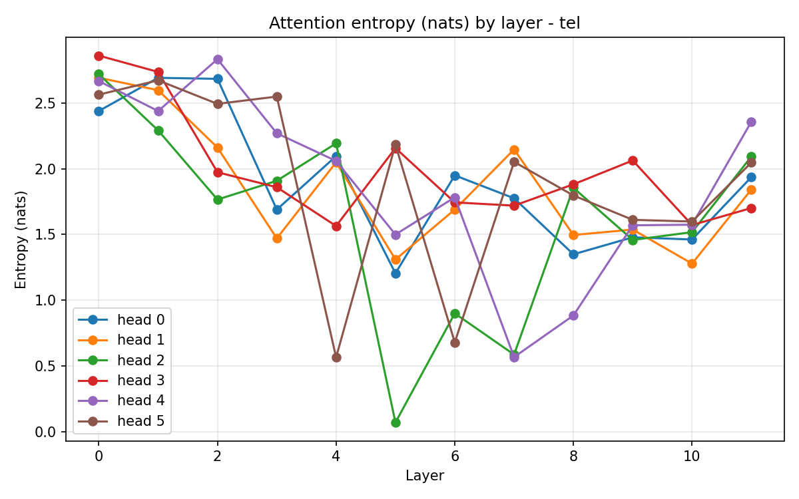

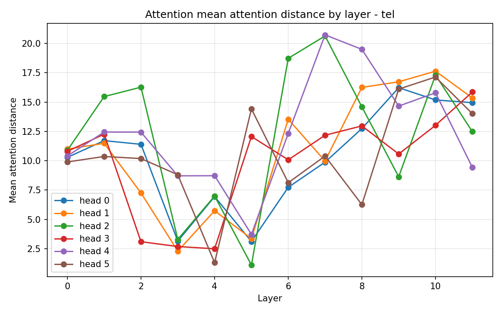

| layer | mean entropy (nats) | mean distance (positions) |
|---:|---:|---:|
| 0 | 2.657 | 10.54 |
| 1 | 2.571 | 12.29 |
| 2 | 2.318 | 10.11 |
| 3 | 1.958 | 4.82 |
| 4 | 1.755 | 5.37 |
| 5 | **1.404** | 6.30 |
| 6 | 1.458 | 11.76 |
| 7 | 1.475 | 13.97 |
| 8 | 1.544 | 13.72 |
| 9 | 1.620 | 13.82 |
| 10 | 1.501 | **16.01** |
| 11 | 1.997 | 13.68 |

**Nepali, 42 heads (7 × 6)**

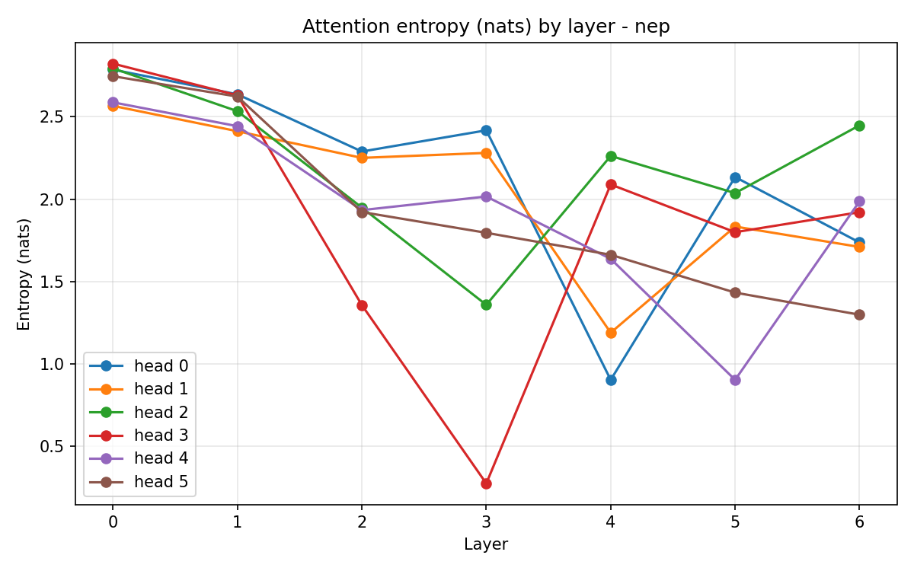

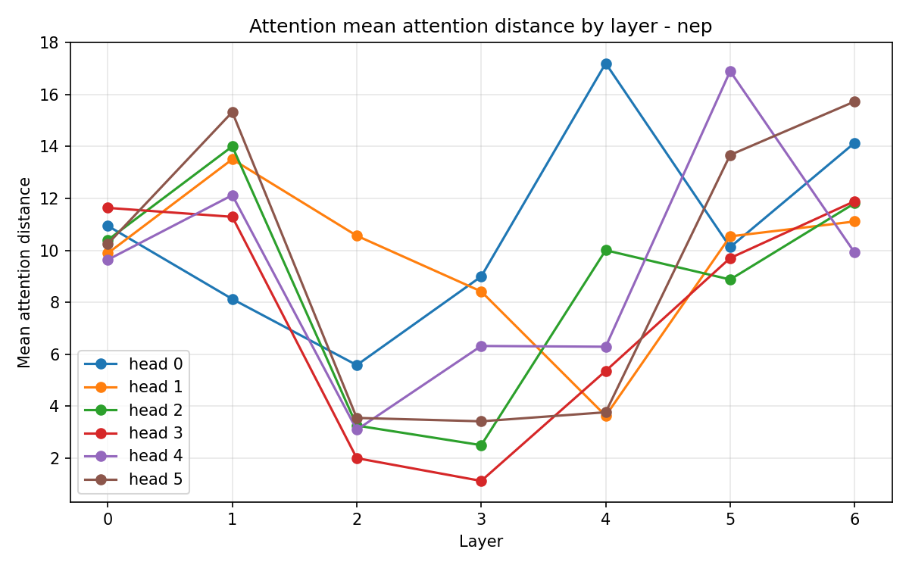

| layer | mean entropy (nats) | mean distance (positions) |
|---:|---:|---:|
| 0 | 2.717 | 10.46 |
| 1 | 2.546 | 12.40 |
| 2 | 1.950 | **4.67** |
| 3 | 1.691 | 5.12 |
| 4 | **1.624** | 7.71 |
| 5 | 1.690 | 11.64 |
| 6 | 1.851 | 12.43 |

**Both models learn the same three-stage structure, compressed to fit the depth
available.**

*Diffuse aggregation.* Layers 0–2 in Telugu, 0–1 in Nepali sit near the entropy
ceiling of 2.931, so attention is close to uniform over the causally available
prefix. These layers aggregate broad context rather than selecting anything.

*Local sharpening.* Telugu layers 3–5 and Nepali layers 2–4 sharpen hard **and**
contract to short range: Telugu reaches distance 4.82 at layer 3, Nepali 4.67 at
layer 2. This is where local, syntax-like structure is computed.

*Long-range retrieval.* Telugu layers 6–11 and Nepali 5–6 stay sharp while
reaching far again: Telugu to 16.01 positions at layer 10, Nepali to 12.43 at
layer 6. Selective *and* distant is the signature of content-based retrieval
rather than positional habit.

Both models also broaden in their final layer (Telugu 1.997, Nepali 1.851). The
last layer feeds the output projection directly, and broadening there is
consistent with mixing several candidate continuations rather than committing to
one source position.

The interesting difference is that **Nepali reaches each stage two layers
earlier**. With 7 layers instead of 12 it cannot afford three diffuse layers at
the bottom, so it transitions at layer 2 rather than 4. It arrives at a similar
organisation on a compressed schedule, but its long-range phase is two layers
deep against Telugu's six, and its maximum attention distance is 12.43 against
16.01. Model L has materially less machinery for long-range composition, which is
the clearest architectural cost of spending half its parameters on the embedding.

### 6.2 Individual heads

| | model | layer | head | entropy | mean distance |
|---|---|---:|---:|---:|---:|
| **Most local** | Telugu | 5 | 2 | **0.070** | **1.11** |
| | Nepali | 3 | 3 | **0.276** | **1.11** |
| **Longest range** | Telugu | 7 | 4 | 0.568 | **20.73** |
| | Nepali | 4 | 0 | 0.904 | **17.21** |
| **Most diffuse** | Telugu | 0 | 3 | 2.860 | 10.80 |
| | Nepali | 0 | 3 | 2.822 | 11.64 |

**Both models learned a previous-token head**, and this is the strongest single
result in the analysis. Telugu layer 5 head 2 has entropy 0.070 nats out of a
possible 2.931 and mean distance 1.11 positions; Nepali layer 3 head 3 has
entropy 0.276 and mean distance **1.11, identical to two decimal places**. Each
attends almost deterministically to the immediately preceding token and nothing
else. Nothing in the architecture privileges that behaviour: it is a learned
positional operation that two independently trained models, on different
languages, corpora and tokenizers, both discovered.

**Both learned sharp long-range heads too.** Telugu layer 7 heads 2 and 4 reach
20+ positions at 0.57–0.59 nats; Nepali layer 4 head 0 and layer 5 head 4 reach
17 positions at 0.90 nats. Sharp *and* distant is the combination that positional
heuristics cannot produce. A head keyed to position would show low variance in
distance, and one keyed to nothing would show high entropy. These select a
specific earlier token by what it is.

Telugu's long-range heads are both sharper (0.568 against 0.904) and reach
further (20.73 against 17.21), consistent with having six layers in which to
develop them rather than two.

### 6.3 The heatmaps

**Telugu**

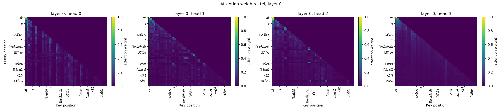

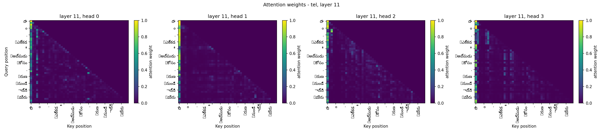

**Nepali**

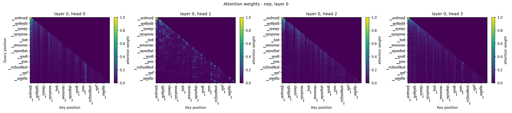

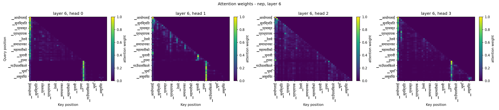

Each figure shows four heads over one held-out sequence, token pieces labelling
both axes.

The **early layers** show the diffuse pattern the entropy numbers predict: weight
spread broadly across the causally available triangle, with faint diagonal bands.
Nothing is strongly selected.

The **late layers** are dominated by a bright vertical stripe at key position 0:
nearly every query attends heavily to the first token regardless of content. This
is the well-documented *attention sink*. Softmax forces each head to distribute a
total weight of 1, so a head with nothing informative to attend to parks that mass
somewhere fixed, usually the first position. It is not a bug and not a failure to
learn; it is what a softmax-normalised head does when it wants to contribute
little. Recognising it matters for reading these maps: the stripe is a null
operation, and the real structure is the fainter diagonal and off-diagonal
activity beside it.

Every map is **strictly lower-triangular**, with the upper triangle exactly zero
throughout. That is a visual confirmation of the same property §2.2 verified
numerically, on both models.

## 7. Resource-level comparison

### 7.1 Everything side by side

| | Telugu (Model H) | Nepali (Model L) |
|---|---:|---:|
| **Corpus** | | |
| Training tokens | 639,877,839 | 497,000,869 |
| Documents | 1,097,873 | ~1.2M |
| Manual share | 15.26% | 8.34% |
| Bytes per token | 10.00 | 13.01 |
| **Tokenizer** | | |
| Algorithm | unigram | unigram |
| Vocabulary | 8,000 | 32,000 |
| Fertility (tokens/word, Phase 1) | 1.810 | 1.310 |
| **Model** | | |
| Parameters | 24,562,944 | 24,906,624 |
| Layers | 12 | 7 |
| Embedding share | 13.3% | **50.1%** |
| **Training** | | |
| Steps | 20,700 | 16,000 |
| Tokens seen | 1,356.6M | 1,048.6M |
| Epochs | 2.12 | 2.11 |
| Wall clock | 8.6 h | 7.3 h |
| **Results** | | |
| Test cross-entropy | 3.1843 | 4.0838 |
| Test perplexity | 24.15 | 59.37 |
| **Test bits per byte** | **0.4588** | **0.4529** |
| Greedy 4-gram repetition | 0.628 | 0.396 |
| chrF++ at T = 1.0 | 18.23 | 19.22 |

### 7.2 The headline: parity on the only fair measure

Model L reaches **0.4529 bits per byte against Model H's 0.4588**, a 1.3% edge,
despite:

- 22% less training data (497.0M against 639.9M tokens)
- roughly half the manual share (8.34% against 15.26%)
- 7 transformer layers against 12
- half its parameters locked up in the embedding

On perplexity the picture inverts completely (59.37 against 24.15). Anyone
reporting only perplexity would conclude Model L is 2.5× worse. It is not; the
number is measuring the tokenizers.

### 7.3 Where the tokenizer decision propagated

The single most consequential choice in this project was made in Phase 1: the
vocabulary sizes, selected independently per language by a fertility sweep on
held-out text. Telugu's sweep picked 8,000; Nepali's picked 32,000. Everything
downstream follows.

**It set the architecture.** A 32,000-piece embedding costs 12.29M parameters at
`d_model=384`. Against a ~25M budget that leaves 12.4M for transformer blocks,
so 7 layers. Telugu's 8,000-piece embedding costs 3.07M, leaving 21.3M, so 12 layers.
Model L trades **five transformer layers for vocabulary coverage**, and the
attention analysis in §6 shows exactly what that buys and costs: the same
three-stage organisation, compressed, with a long-range phase two layers deep
instead of six and a shorter maximum attention distance (12.43 against 16.01).

**It set the units of measurement.** 13.0 bytes per token against 10.0 means
Nepali predictions cover more text each. Perplexity is per token, so it is
inflated for Nepali by construction; bits-per-byte divides that out.

**Without weight tying, Model L could not exist at this budget.** Tying saves
12.29M parameters for Nepali against 3.07M for Telugu. An untied Model L would
need 37M parameters for the same 7 layers.

### 7.4 Why the resource gap didn't produce the expected quality gap

Three reasons, in descending order of confidence.

**A larger vocabulary is genuinely more parameter-efficient per byte.** Each
Nepali token carries 30% more text. Fewer prediction steps per byte means fewer
opportunities to accumulate error, which partly offsets each individual
prediction being harder. This is a real effect and it is what bits-per-byte is
designed to expose.

**Both models are compute-limited, not data-limited.** Both curves were still
descending when the cosine schedule ran out, and neither shows meaningful
overfitting at ~2.1 epochs. Nepali's training loss actually sits *above* its
validation loss at the end. A corpus difference of 22% barely registers when
neither model has extracted what is already available. The gap would likely open
up with substantially more training.

**And part of it may be an artefact of corpus quality**, which is the honest
caveat. §5.3 documents that a substantial part of the Nepali held-out data is
word-level shuffled rather than running prose. Shuffled text destroys long-range
structure, which ought to make it *harder* to model, not easier, so the naive
expectation is that this hurts Nepali's numbers rather than flattering them. But
these measurements cannot settle the direction, and the Nepali bits-per-byte
figure should be read with that uncertainty attached.

### 7.5 What the two models actually learned

Both produce **well-formed orthography** in their language: correct conjunct
consonants, plausible morphology, sensible sentence boundaries. Neither
holds a topic across 64 tokens. That is the expected profile at 25M parameters
and ~1.3B training tokens.

The repetition contrast is the clearest behavioural difference: greedy decoding
loops on **62.8%** of Telugu 4-grams against **39.6%** of Nepali's. Telugu's
finer tokenization means more tokens per phrase and more opportunity for a
locked-in loop to compound. Both fall to near zero by temperature 1.0.

### 7.6 What I would change

1. **Audit the Nepali corpus first.** The scrambled references in §5.3 are the
   most serious issue found, and they are a Phase 1 problem. Identifying and
   dropping the offending source would change Model L's numbers more than any
   architectural adjustment.
2. **Reconsider Telugu's 8,000 vocabulary.** The selection rule prefers the
   smallest vocabulary within 5% of the best fertility, which pushed it below the
   assignment's recommended "tens of thousands". A 16,000 vocabulary would have
   made the two models more comparable and reduced Telugu's repetition.
3. **Train longer.** Both curves were still falling. The 8-hour session limit,
   not the data or the architecture, is what stopped these runs.
4. **Rotary positional embeddings** instead of learned absolute, which would
   remove the hard 512-token ceiling described in §1.4.

## 8. Deliverables

| # | required | where |
|---|---|---|
| 1 | Transformer implementation (MHA, positional embeddings, causal mask) | `common/model/attention.py`, `block.py`, `transformer.py` |
| 2 | Model configuration files (H and L) | `telugu/configs/model.yaml`, `nepali/configs/model.yaml`; as-run copies in `*/logs/config_*.yaml` |
| 3 | Parameter counts; training scripts; Drive links to checkpoints | §1.5 (24,562,944 / 24,906,624); `scripts/20_train.py`; [tel_best.pt](https://drive.google.com/file/d/1d6-hMx5m91LojrqwT1YYgCW4uuVxcWL_/view?usp=sharing), [nep_best.pt](https://drive.google.com/file/d/1enzNOOGkLtPIlS1a1HQZGt5TZrJcDP4w/view?usp=sharing) |
| 4 | Training logs and loss curves | `telugu/logs/history_tel.json`, `nepali/logs/history_nep.json`; `figures/loss_*.png`, `figures/lr_*.png` |
| 5 | PPL / BPB tables; BLEU, chrF, ROUGE-L | §4, §5; `tables/lm_eval_*.json`, `tables/generation_*.json` |
| 6 | Generated samples and diversity / repetition stats | §5.2–5.3; `tables/samples_*.json` |
| 7 | Attention heatmaps plus entropy / distance summaries | §6; `figures/attention_*.png`, `figures/attn_*.png`; `tables/attention_*.json` |
| 8 | Resource-level comparison write-up | §7 |

All figures carry a title, both axis labels and a legend. Computation lives in
`common/eval/` and `common/stats.py`; plotting is confined to `common/viz.py`.

## 9. Reproducing

```bash
python scripts/19_sanity.py   --lang tel    # parameters, ln(V) loss, causal mask, alignment
python scripts/20_train.py    --lang tel    # resumable pretraining
python scripts/21_evaluate.py --lang tel    # cross-entropy, perplexity, bits-per-byte
python scripts/22_generate.py --lang tel    # BLEU, chrF++, ROUGE-L, diversity
python scripts/23_attention.py --lang tel   # heatmaps, entropy, mean distance
python scripts/24_phase2_report.py          # assembles this file
```

or `python scripts/run_phase2.py --lang tel` for all of it. Training is
resumable; re-running after an interrupted session continues from the last
checkpoint.
